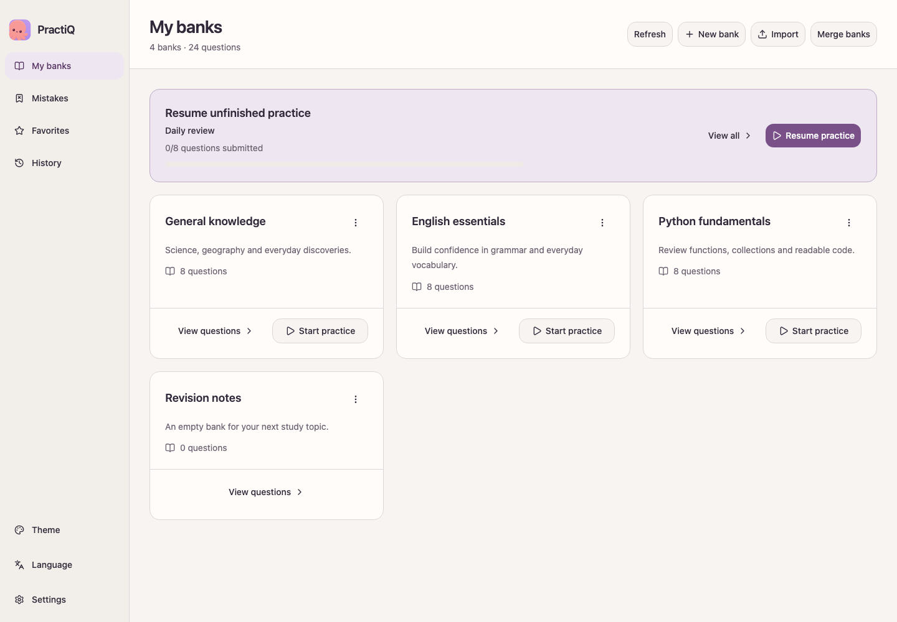
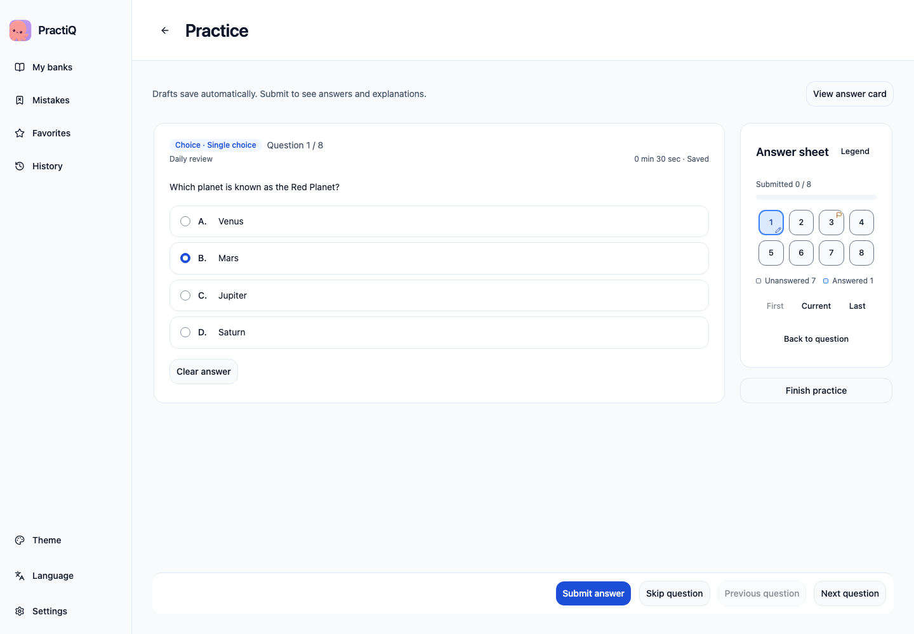
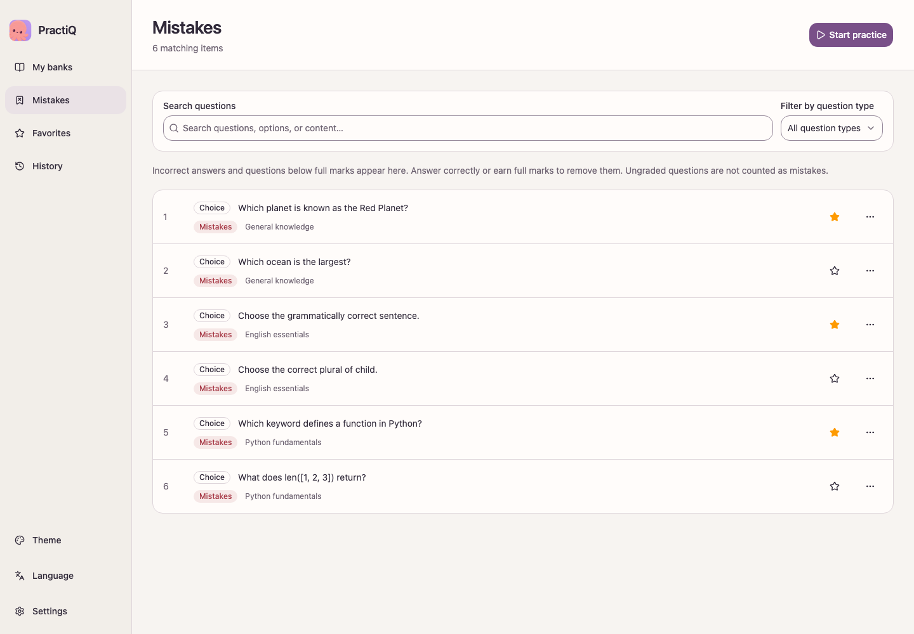
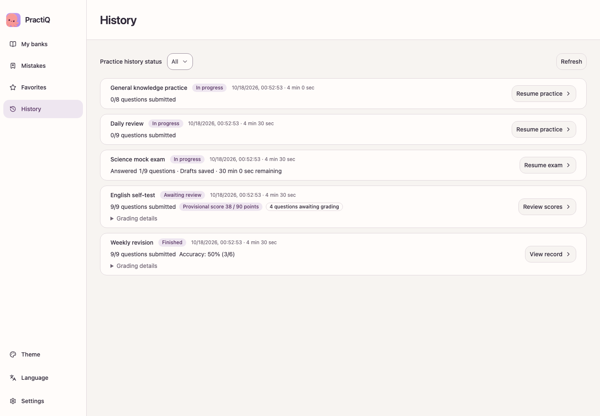

<p align="center">
  
</p>

# PractiQ

English | [简体中文](README.zh-CN.md) | [繁體中文](README.zh-TW.md)

Turn documents into question banks, then practise and take mock exams offline on macOS.

- **Import and review**: pull questions out of documents with AI, check anything that needs a second look, and organise your banks.
- **Practise and test**: choose questions across banks by type, mistakes, bookmarks or unanswered questions, then practise, self-test or run a timed mock exam.
- **Review scores**: score objective questions on your device, ask AI to grade short answers, or adjust marks yourself.
- **Review and track learning**: revisit suggested questions, view 7- or 30-day statistics, and keep personal notes and mistake causes.
- **Keep and share**: pick up a session where you left off, back up your records, and share a bank with its images and audio as a ZIP file.

PractiQ works in English, Simplified Chinese and Traditional Chinese, with light and dark themes, seven basic question types and English listening, reading, cloze, translation and writing. Practice records stay on your device, with no account and no cloud sync. AI import sends documents to your self-hosted service, Tencent Cloud and your configured model provider; optional AI grading sends grading content to the selected endpoint.

## Screenshots

These screenshots were captured on **2026-10-29** from the desktop browser preview at [`af7ab2ff`](https://github.com/shenyankm/PractiQ/commit/af7ab2ff3bf4a392103b403d73b70f0d1a5cd533), in English with hand-written sample banks and practice records. All data is held in memory; no credentials, uploads or model calls were used. Click an image to view it at full size.

| Question banks | Practice |
| :---: | :---: |
| [](docs/assets/screenshots/banks-en.png) | [](docs/assets/screenshots/practice-en.png) |
| **Mistakes** | **Practice history** |
| [](docs/assets/screenshots/mistakes-en.png) | [](docs/assets/screenshots/history-en.png) |

## Try it without a model

[Install PractiQ](#install), then:

1. When **My banks** is empty, choose **Add example bank**, or import [sample.zip](app/fixtures/sample.zip) through **Settings → Import and restore → Import bank ZIP**. More examples: [composite questions](app/fixtures/composite.zip) and [all question types](app/fixtures/all-types.zip).
2. Open the bank and choose **Start practice**. Try practice with instant feedback, an untimed self-test or a timed mock exam.
3. Submit your answers and review the scores and explanations.

No API key is needed; the samples only show question types and review flags.

Export a bank from its card menu to share its questions without your answers or scores. Importing a bank ZIP adds content, while restoring a full backup replaces your data after confirmation. See the [practice guide](docs/guides/practice-guide.md) and [package guide](docs/guides/question-bank-package.md).

## Import documents with AI

Document import runs in the Web page of the self-hosted AI service:

1. [Start the service](#self-host-the-import-service), open its Web page and start importing without a login.
2. Choose up to 10 files and select **Start import**. Choosing files does not upload or parse them.
3. Review the questions, images and anything flagged for review, then download a question-bank ZIP.
4. In the desktop app, open **Settings → Import and restore → Import bank ZIP**.

The service reads **PDF, TXT, Markdown, PNG/JPEG, DOC, DOCX, PPT, PPTX, XLS and XLSX** with Tencent Cloud's [asynchronous multimodal document parsing](https://cloud.tencent.com/document/api/866/139312). New CSV imports are not supported. Tencent's [billing guide](https://cloud.tencent.com/document/product/866/17619) lists a one-time **1,000-page free allowance**, valid for one year; check eligibility and remaining quota in your Tencent account. Parsing and model calls are billed separately.

By default, import extracts supplied answers and explanations. To fill missing answers or explanations, enable **AI 生成答案与解析** in the Web settings, wait for it to save, then explicitly select **Start import**. Existing answers are preserved; generated content is marked for review and shares the task's model-call budget.

Reading and downloading results never calls a model. Resuming, retrying or parsing again may cost money at your model provider. Download what you want to keep within **180 days**; a task expiring never affects banks you already imported. See the [import task guide](docs/guides/import-tasks.md).

## Grade short answers with AI

Open **Settings → AI service**, choose **Direct model API** and enter an OpenAI-compatible Chat Completions API address (including the `/v1` or other base path your provider requires), model ID and your own API key. Offline practice and local scoring need none of this.

Grading needs a reference answer or rubric, may cost money, and sends the current question, materials, images and your answer to the provider you chose. Each action makes at most one request, and an unknown result is never resent automatically. Keys stay in the system credential store and out of backups. See the [practice guide](docs/guides/practice-guide.md) for limits and retry rules.

Ordinary practice supports explicit grading after submitting the current short answer; tests and exams still require paper submission. New results show individual scoring points and verified reference/answer quotations. Practice uses a 100-point scale if no source maximum was supplied. Independent human-labelled grading-quality acceptance remains pending.

## Install

Download the macOS 14+ Apple Silicon installer from [PractiQ v0.2.2](https://github.com/shenyankm/PractiQ/releases/tag/v0.2.2). This release is unsigned and not notarized; read the release notes for checksums, installation steps and incomplete acceptance checks.

This README describes the current source; published installers may not include every later source change. Earlier releases and prereleases remain available on [GitHub Releases](https://github.com/shenyankm/PractiQ/releases).

To build from source, open the repository root and ask your coding agent to use this prompt:

> Read `docs/guides/installation.md` and install PractiQ on this machine. Check the requirements first, run only the steps for my platform, and tell me what you ran, where the build is and anything that failed. Ask before installing system packages.

The [installation guide](docs/guides/installation.md) covers requirements, commands and checks. PractiQ runs on macOS 14+ (Apple Silicon); Linux is supported only for the AI service and CI.

PractiQ is still in development. A passing build does not establish signing, clean-machine acceptance or live-model accuracy. Published packages and their evidence are listed on [GitHub Releases](https://github.com/shenyankm/PractiQ/releases).

Desktop data lives in `v4/` with SQLite schema 11. Full backups use container version 4 and schema 11; earlier backups with those versions remain supported. Older schemas are rejected without migration, older directories are left untouched, and current question-bank ZIP files still import. See the [data format boundaries](docs/reference/question-model.md#versions-and-directories).

## Self-host the import service

Document import needs the self-hosted AI service. It requires Python 3.14+, uv, Node.js 22.12+, PostgreSQL, RabbitMQ, Tencent parsing credentials and a model endpoint supporting the Responses API with text, images and structured output. Keep the service on loopback. The [installation guide](docs/guides/installation.md), [personal-use guide](server/docs/personal-use.md) and [Tencent setup guide](server/docs/tencent-document-parser.md) cover setup and upgrades; configure your own providers, with charges paid directly and no PractiQ billing.

## Documentation and development

Start with the [documentation index](docs/README.md). It links the [question model](docs/reference/question-model.md), [document task API](server/docs/document-tasks.md), [operations](server/docs/operations.md) and contributor guides. Run `make app-check`, `make web-check` or `make verify` for the part you changed; Playwright covers interactions in all three app languages with mocked native commands and no model calls:

```sh
cd app
npx playwright install chromium --only-shell
npm run test:browser
```

## Get help and contribute

Report reproducible bugs or propose improvements through [GitHub Issues](https://github.com/shenyankm/PractiQ/issues/new/choose). Follow [the contribution guide](CONTRIBUTING.md) for changes and [the security policy](SECURITY.md) for private vulnerability reports.

Project source uses the [MIT license](LICENSE). Bundled dependencies retain their [upstream notices](app/licenses/README.md).
