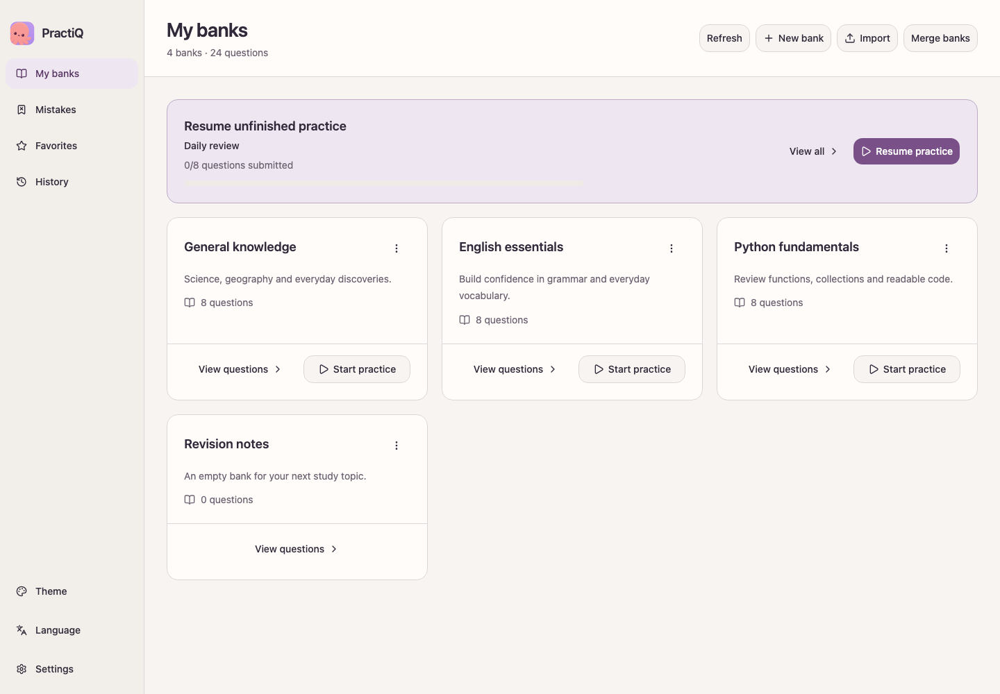
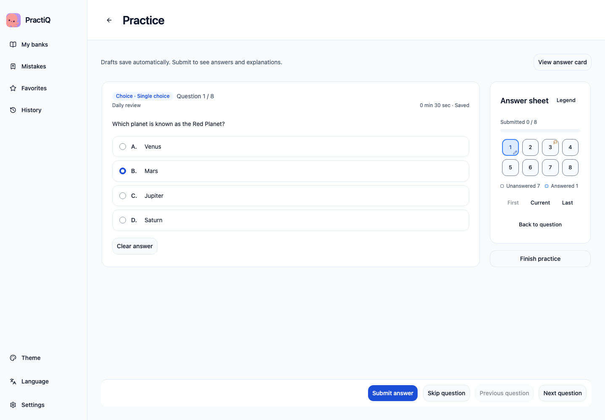
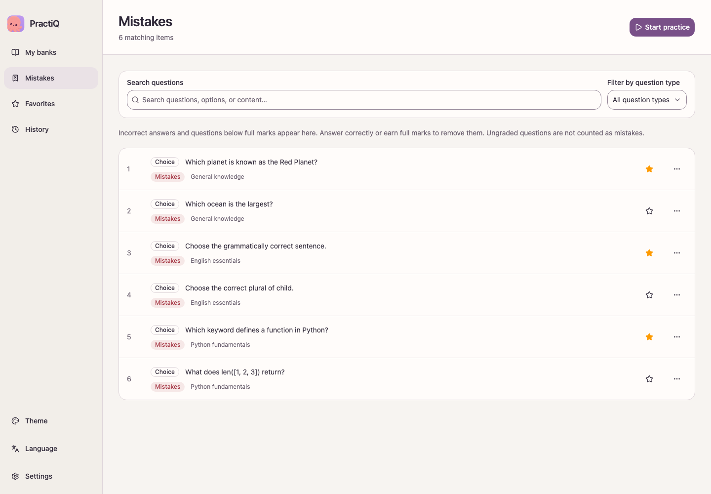
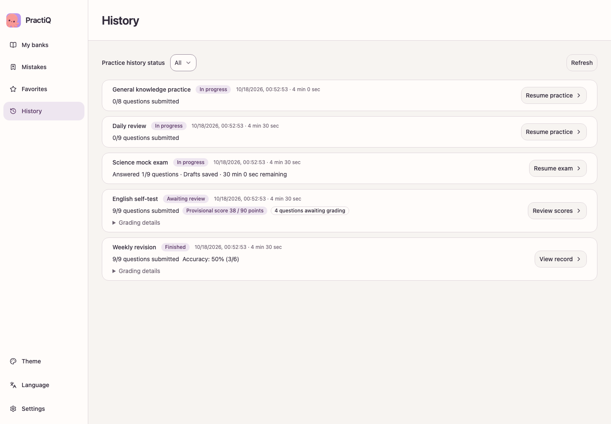

<p align="center">
  
</p>

# PractiQ

[English](README.md) | 简体中文 | [繁體中文](README.zh-TW.md)

把文档变成题库，在 macOS 上离线练习和模拟考试。

- **导入与复核**：用 AI 从文档中提取题目，检查需要复核的内容，整理自己的题库。
- **练习与组卷**：跨题库按题型、错题、收藏或未做题挑选题目，进行练习、自测或限时模考。
- **查看评分**：客观题立即在本机判分，简答题可交给 AI 评分，也可以自己改分。
- **复习与记录**：按推荐题目复习，查看近 7 天或 30 天的学习统计，记录个人笔记和错因。
- **保存与分享**：下次接着上次的进度练习，备份个人记录，把题库连同图片和音频导出为 ZIP 分享。

应用提供简体中文、繁体中文和英文界面，支持明暗主题、七种基础题型，以及英语听力、阅读、完形填空、翻译和写作。练习记录保存在你的设备上，不需要账号，也不会同步到云端。AI 导入会将文档发送至自建服务、腾讯云及配置的模型供应商；可选的 AI 批改会将评分内容发送至所选接口。

## 截图

以下截图于 **2026-10-29** 基于源码 [`af7ab2ff`](https://github.com/shenyankm/PractiQ/commit/af7ab2ff3bf4a392103b403d73b70f0d1a5cd533) 的桌面界面浏览器预览拍摄，界面为英文，题库和练习记录均为人工编写的示例。所有数据只保存在内存中，没有输入凭据、上传文件或调用模型。点击图片可查看原图。

| 题库 | 答题 |
| :---: | :---: |
| [](docs/assets/screenshots/banks-en.png) | [](docs/assets/screenshots/practice-en.png) |
| **错题** | **练习记录** |
| [](docs/assets/screenshots/mistakes-en.png) | [](docs/assets/screenshots/history-en.png) |

## 先体验：无需配置模型

[安装 PractiQ](#安装)后：

1. “我的题库”为空时，点击**添加示例题库**；也可以依次打开**设置 → 导入与恢复 → 导入题库 ZIP**，导入 [sample.zip](app/fixtures/sample.zip)。更多示例：[复合题](app/fixtures/composite.zip)、[全题型](app/fixtures/all-types.zip)。
2. 打开题库并点击**开始练习**，体验即时反馈练习、不限时自测或限时模考。
3. 提交作答，查看评分和解析。

全程不需要 API Key；示例只用于展示题型和待复核标记。

在题库卡片的菜单中选择导出，即可分享题目而不包含你的作答和评分。导入题库 ZIP 会把内容追加到现有题库，恢复完整备份则会在确认后替换个人数据。详见[练习指南（英文）](docs/guides/practice-guide.md)和[题库包指南](docs/guides/question-bank-package.md)。

## 用 AI 导入文档

在 macOS App 的**个人中心 → 导入工作区**中上传文档，识别、解析与模型调用仍由云端服务完成：

1. [启动服务](#自建导入服务)，在 App 中连接服务地址并登录或注册。离线练习仍无需登录。
2. 一次最多选择 10 份文件，点击**开始导入**。只选择文件不会上传或解析。
3. 检查题目、图片和需要复核的内容，然后下载题库 ZIP。
4. 在桌面应用中打开**设置 → 导入与恢复 → 导入题库 ZIP**。

服务通过腾讯云的[异步多模态文档解析](https://cloud.tencent.com/document/api/866/139312)读取 **PDF、TXT、Markdown、PNG/JPEG、DOC、DOCX、PPT、PPTX、XLS 和 XLSX**，不支持新建 CSV 导入。腾讯云[计费说明](https://cloud.tencent.com/document/product/866/17619)列有首次开通的一次性 **1,000 页免费额度，有效期一年**；领取资格和剩余额度以腾讯云账号为准。文档解析与模型调用分别计费。

默认只提取原文已有的答案和解析。如需补充缺失内容，在 App 的云端工作区设置中开启**AI 生成答案与解析**，等待保存成功，再点击**开始导入**。原有答案会保留，生成内容标记为待核对，并共享任务的模型调用预算。

查看和下载结果不会调用模型；继续、重试或重新解析可能产生供应商费用。请在 **180 天**内下载需要保留的结果，任务过期不影响已导入的题库。详见[导入任务指南](docs/guides/import-tasks.md)。

## 用 AI 批改主观题

打开**设置 → AI 服务**，选择**直连模型 API**，填写兼容 OpenAI Chat Completions 的 API 地址（包含 `/v1` 或供应商要求的基础路径）、模型 ID 和自己的 API Key。离线练习和本地判分不需要这些设置。

批改需要参考答案或评分细则，可能产生费用，并会把当前题目、材料、图片和你的作答发送给所选供应商。每次操作最多请求一次，结果不明时不会自动重发。密钥保存在系统凭据存储中，不会进入备份。详见[练习指南（英文）](docs/guides/practice-guide.md)中的批改限制与重试规则。

普通练习提交当前简答题后也可主动评分；自测和模拟考试仍需先交卷。评分结果展示逐项得分、评分依据和作答引用，并校验引用与分数合计；原题未提供分值时，练习按百分制评分。评分仍用于个人辅助核对，独立人工标注的质量验收尚未完成。

## 安装

前往 [PractiQ v0.2.2](https://github.com/shenyankm/PractiQ/releases/tag/v0.2.2) 下载 macOS 14+、Apple Silicon 安装包。此版本尚未签名或公证；校验和、安装步骤及未完成的验收项见发布说明。

本 README 描述当前源码，已发布安装包可能尚未包含后续源码改动。早期版本和预发布版仍可在 [GitHub Releases](https://github.com/shenyankm/PractiQ/releases) 中获取。

如需从源码构建，打开仓库根目录，让 AI 编程助手使用以下提示：

> 阅读 `docs/guides/installation.md`，在这台电脑上安装 PractiQ。先检查环境要求，只执行适合我系统的步骤，完成后告诉我执行了哪些命令、安装包在哪里，以及哪些步骤失败。安装系统软件前先问我。

[安装指南（英文）](docs/guides/installation.md)包含环境要求、命令和检查步骤。应用支持 macOS 14+（Apple Silicon）；Linux 仅用于运行 AI 服务和 CI。

PractiQ 仍在开发中。构建通过不代表已完成签名、干净环境验收或真实模型准确性验证。已发布的安装包和验证证据见 [GitHub Releases](https://github.com/shenyankm/PractiQ/releases)。

桌面数据保存在 `v4/` 目录中，SQLite schema 为 11。完整备份使用容器版本 4、schema 11；此前使用相同版本的备份仍受支持。更旧的 schema 不会自动迁移，旧目录原样保留，当前格式的题库 ZIP 仍可导入。详见[数据格式说明](docs/reference/question-model.md#versions-and-directories)。

## 自建导入服务

文档导入需要自建 AI 服务，需要 Python 3.14+、uv、Node.js 22.12+、PostgreSQL、RabbitMQ、腾讯云解析凭据，以及支持 Responses API、文字与图片输入和结构化输出的模型接口。服务应绑定本机回环地址。[安装指南（英文）](docs/guides/installation.md)、[个人自托管指南](server/docs/personal-use.md)和[腾讯云配置指南](server/docs/tencent-document-parser.md)说明部署与升级；自建部署的供应商配置由你提供，费用直接支付给供应商。运营方可选开启云端套餐收款，默认关闭，详见[套餐规则](docs/guides/plans.md)。

## 文档与开发

先看[文档索引（英文）](docs/README.md)，其中有[题型模型](docs/reference/question-model.md)、[文档任务 API](server/docs/document-tasks.md)、[部署与运维](server/docs/operations.md)和贡献指南。按改动的部分运行 `make app-check`、`make web-check` 或 `make verify`；Playwright 覆盖应用的三语交互，使用模拟原生命令，不调用模型：

```sh
cd app
npx playwright install chromium --only-shell
npm run test:browser
```

## 获取帮助与参与贡献

请通过 [GitHub Issues](https://github.com/shenyankm/PractiQ/issues/new/choose) 报告可复现的问题或提出改进建议。代码和文档贡献请阅读[贡献指南](CONTRIBUTING.md)，安全漏洞请按[安全策略](SECURITY.md)私下报告。

项目源码使用 [MIT 许可证](LICENSE)，内置依赖保留各自的[上游许可声明](app/licenses/README.md)。

Web 仅保留管理后台；用户账号、额度、任务、结果和订单均在 App 中操作。新用户共有 50 页免费识别额度，不按日恢复。邮箱暂不验证，忘记密码需向管理员获取一次性重置码。详见[云端服务指南（英文）](docs/guides/cloud-service.md)。

套餐与额度：Free 注册赠送共计 50 页；Plus ¥39／100 页／30 天，Pro ¥99／300 页／30 天，加量包 ¥19.90／50 页／365 天。手动购买，不自动续费；仅经验证的正式付款发放独立权益，支付默认关闭。服务 schema 8 需离线备份升级，本地练习不受影响。详见[套餐规则](docs/guides/plans.md)。
