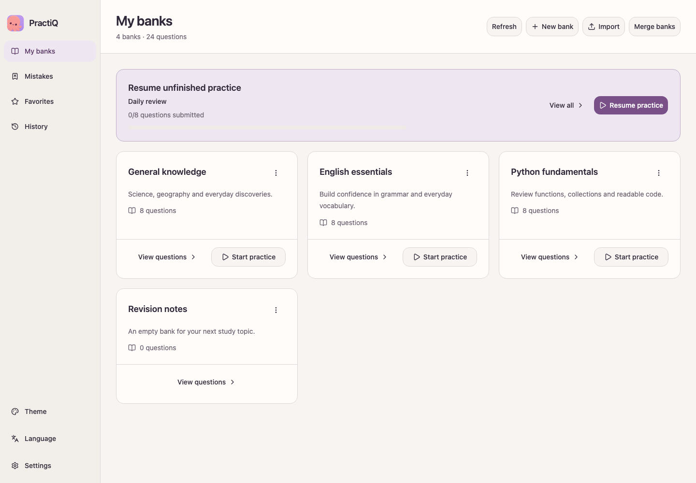
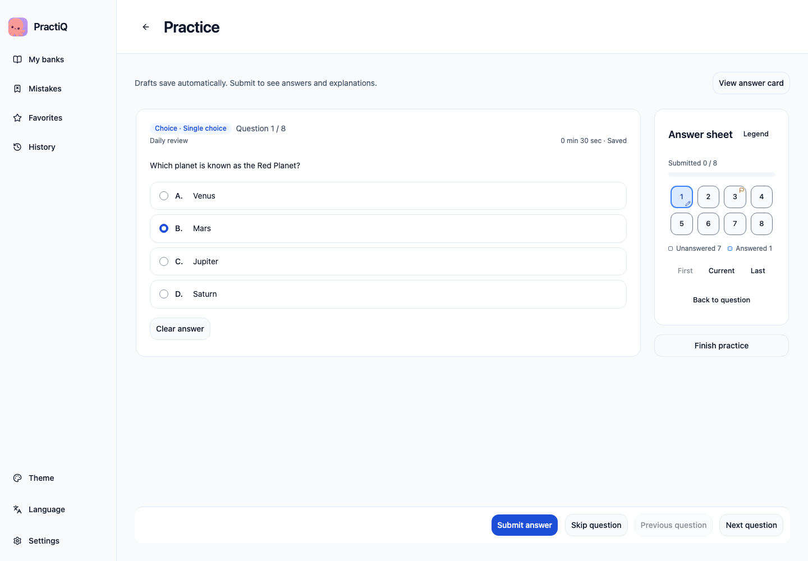
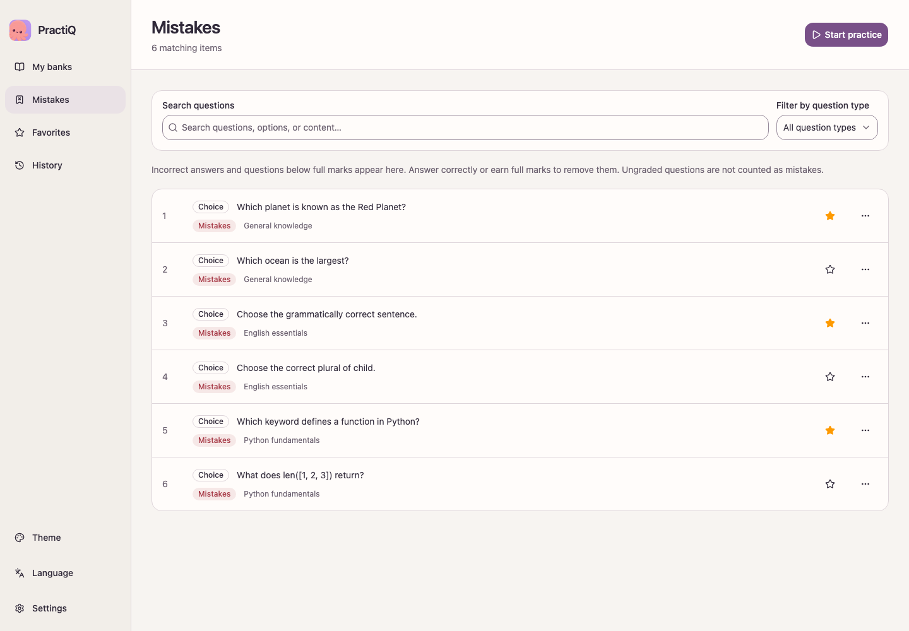
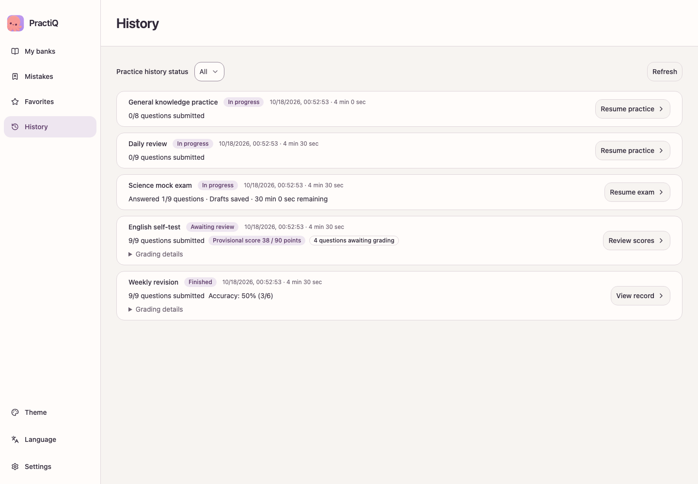

<p align="center">
  
</p>

# PractiQ

[English](README.md) | [简体中文](README.zh-CN.md) | 繁體中文

將文件轉成題庫，在 macOS 上離線練習與模擬考。

- **匯入與複核**：用 AI 從文件中擷取題目，檢查需要複核的內容，整理自己的題庫。
- **練習與組卷**：跨題庫依題型、錯題、收藏或未作答題目挑選題目，進行練習、自我測驗或限時模擬考。
- **查看評分**：客觀題立即在本機評分，簡答題可交由 AI 評分，也可以自行調整分數。
- **複習與紀錄**：依推薦題目複習，查看近 7 天或 30 天的學習統計，記錄個人筆記與錯因。
- **儲存與分享**：下次接續上次的進度練習，備份個人紀錄，將題庫連同圖片與音訊匯出為 ZIP 分享。

應用程式提供簡體中文、繁體中文與英文介面，支援淺色與深色主題、七種基本題型，以及英語聽力、閱讀、克漏字、翻譯與寫作。練習紀錄儲存在你的裝置上，不需要帳號，也不會同步到雲端。主動開始 AI 匯入會將文件傳送至騰訊雲與設定的模型供應商；選用的 AI 批改會將評分內容傳送至所選端點。

本文件採用台灣繁體中文用語；應用程式提供繁體中文介面，下列操作名稱以繁體中文介面為準。


目前原始碼建置為一個 Electron 應用程式，內建 Node 工作處理程序、LangGraph.js、SQLite 與本機檔案儲存。匯入和評分共用**設定 → AI 模型與辨識**中的設定，無需另行啟動服務。遷移驗收與剩餘工作見[驗收紀錄](docs/maintainers/electron-migration.md)。


## 螢幕截圖

以下截圖於 **2026-10-29** 使用原始碼 [`af7ab2ff`](https://github.com/shenyankm/PractiQ/commit/af7ab2ff3bf4a392103b403d73b70f0d1a5cd533) 的桌面介面瀏覽器預覽拍攝，介面為英文，題庫與練習紀錄皆為人工編寫的範例。所有資料只存放在記憶體中，未輸入憑證、上傳檔案或呼叫模型。點選圖片即可查看原始大小。

| 題庫 | 作答 |
| :---: | :---: |
| [](docs/assets/screenshots/banks-en.png) | [](docs/assets/screenshots/practice-en.png) |
| **錯題** | **練習紀錄** |
| [](docs/assets/screenshots/mistakes-en.png) | [](docs/assets/screenshots/history-en.png) |

## 先試用：不需設定模型

[安裝 PractiQ](#安裝)後：

1. 「我的題庫」尚無題庫時，點選**新增範例題庫**；也可依序開啟**設定 → 匯入與還原 → 匯入題庫 ZIP**，匯入 [sample.zip](app/fixtures/sample.zip)。其他範例包括[複合題](app/fixtures/composite.zip)與[所有題型](app/fixtures/all-types-no-recordings.zip)。
2. 開啟題庫並點選**開始練習**，體驗即時回饋練習、不限時自我測驗或限時模擬考。
3. 提交答案，查看評分與解析。

全程不需要 API 金鑰；範例只用於展示題型與待複核標記。

在題庫卡片的選單中匯出，即可分享題目而不包含你的作答與評分。匯入題庫 ZIP 會將內容加入現有題庫，還原完整備份則會在你確認後取代個人資料。詳見[練習指南（英文）](docs/guides/practice-guide.md)與[題庫套件指南（英文）](docs/guides/question-bank-package.md)。

## 使用 AI 匯入文件

直接在 macOS App 中匯入文件：

1. 在**設定 → AI 模型與辨識**中設定模型位址、ID、API 金鑰與騰訊憑證，儲存後開啟**文件匯入**，不需登入。
2. 一次最多選擇 10 份檔案，點選**開始匯入**。僅選擇檔案不會上傳或解析。
3. 檢查題目、圖片與需要複核的內容，再點選**匯入題庫**。App 讀取已儲存的結果並驗證配圖，寫入本機題庫，無需下載或匯入 ZIP。

App 透過騰訊雲的[非同步多模態文件解析](https://cloud.tencent.com/document/api/866/139312)讀取 **PDF、TXT、Markdown、PNG/JPEG、DOC、DOCX、PPT、PPTX、XLS 及 XLSX**，不支援新建 CSV 匯入。文件解析與模型呼叫分別計費，目前價格與額度以供應商帳號為準。Office 檔案超過目前傳輸或類型限制時，須先匯出為 PDF 再匯入；應用程式不使用 Python 或 LibreOffice 安裝。

預設僅擷取原文已有的答案與解析。如需補充缺漏內容，在 App 設定中啟用補齊缺失答案與解析的選項，等待儲存成功，再點選**開始匯入**。原有答案會保留，產生內容標記為待核對，並共用匯入作業的模型呼叫預算。

查看與下載結果不會呼叫模型；接續、重試或重新解析可能產生供應商費用。請在 **180 天**內下載需要保留的結果，匯入作業到期不影響已匯入的題庫。詳見[匯入任務指南（英文）](docs/guides/import-tasks.md)。

## 使用 AI 批改主觀題

文件匯入和 AI 評分共用**設定 → AI 模型與辨識**中的模型設定。離線練習與本機評分無需憑證或網路連線。

批改必須有參考答案或評分規準，可能產生費用，並會將目前題目、材料、圖片與你的作答傳送給所選供應商。每次操作最多請求一次，結果不明時不會自動重新傳送。目前金鑰由 macOS 系統保護並加密儲存在本機，不會納入學習備份。詳見[練習指南（英文）](docs/guides/practice-guide.md)中的批改限制與重試規則。

一般練習提交目前簡答題後也可主動評分；自我測驗與模擬考仍須先交卷。評分結果顯示逐項得分、評分依據與作答引文，並驗證引文與分數總和；原題未提供分值時，練習採百分制評分。評分仍用於個人輔助核對，獨立人工標註的品質驗收尚未完成。

## 安裝

前往 [PractiQ v0.2.2](https://github.com/shenyankm/PractiQ/releases/tag/v0.2.2) 下載 macOS 14+、Apple Silicon 安裝套件。此版本尚未簽章或公證；校驗碼、安裝步驟及未完成的驗收項目請見發布說明。

本 README 描述目前原始碼，已發布安裝套件可能尚未包含後續原始碼變更。早期版本與預發布版仍可在 [GitHub Releases](https://github.com/shenyankm/PractiQ/releases) 中取得。

如需從原始碼建置，開啟儲存庫根目錄，讓 AI 程式設計助理使用以下提示：

> 閱讀 `docs/guides/installation.md`，在這台電腦上安裝 PractiQ。先檢查環境需求，只執行適合我系統的步驟，完成後告訴我執行了哪些指令、安裝套件在哪裡，以及哪些步驟失敗。安裝系統軟體前先問我。

[安裝指南（英文）](docs/guides/installation.md)包含環境需求、指令與檢查步驟。應用程式面向 macOS 14+（Apple Silicon），其他桌面平台尚未驗收。

PractiQ 仍在開發中。建置通過不代表已完成簽章、乾淨環境驗收或真實模型準確性驗證。已發布的安裝套件與驗證證據請見 [GitHub Releases](https://github.com/shenyankm/PractiQ/releases)。

桌面資料儲存在 `v4/` 目錄中，SQLite schema 為 11。完整備份使用容器版本 4、schema 11；先前使用相同版本的備份仍受支援。更舊的 schema 不會自動遷移，舊目錄會原樣保留，目前格式的題庫 ZIP 仍可匯入。詳見[資料格式說明（英文）](docs/reference/question-model.md#versions-and-directories)。

## 本機資料與 AI 工作處理程序

練習資料與 AI 作業分別儲存在本機 SQLite 資料庫中。學習備份包含練習紀錄與引用資源，不包含 AI 作業與目前憑證。新增聽力僅儲存 QR Code 辨識出的播放位址或手動填寫的位址，音訊在記憶體中播放；歷史錄音仍相容。既有資料、Keychain 命名空間與歷史服務資料卷保留。舊服務文件與報告用於遷移參考，不是目前安裝步驟。

## 文件與開發


```sh
make install
make dev
make verify
cd app
npx playwright install chromium --only-shell
npm run test:browser
```

## 取得協助與參與貢獻

請透過 [GitHub Issues](https://github.com/shenyankm/PractiQ/issues/new/choose) 回報可重現的問題或提出改善建議。程式碼與文件貢獻請閱讀[貢獻指南（英文）](CONTRIBUTING.md)，安全漏洞請依[安全政策（英文）](SECURITY.md)私下回報。

專案原始碼採用 [MIT 授權條款](LICENSE)，內建相依套件保留各自的[上游授權聲明（英文）](app/licenses/README.md)。
