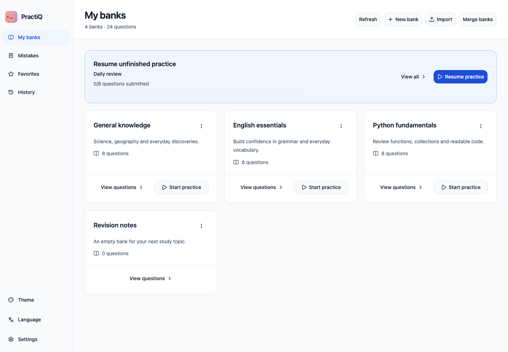
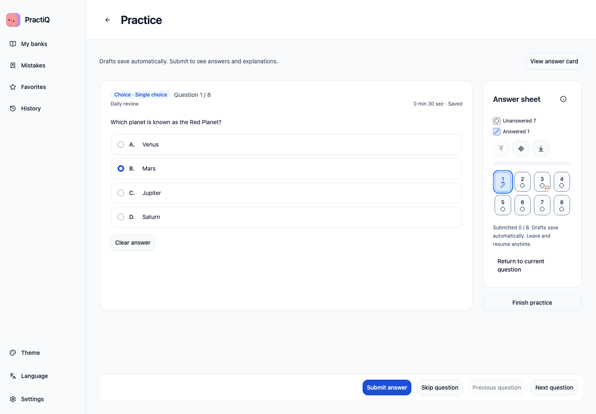
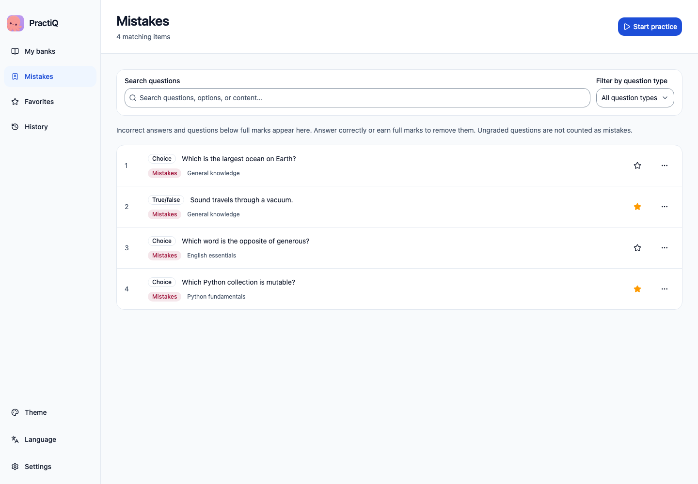
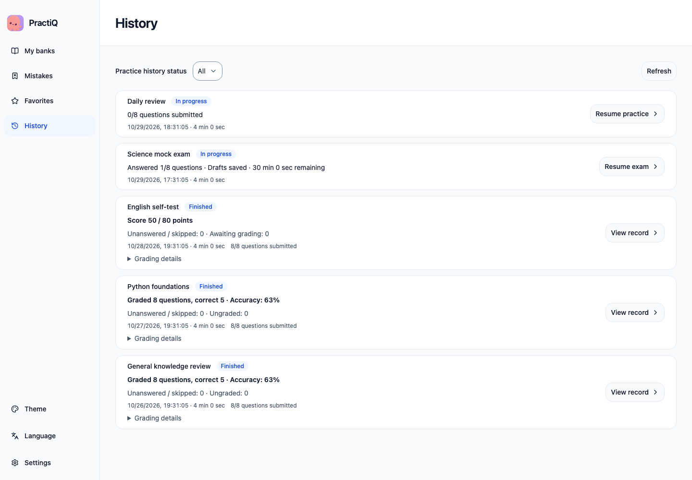

<p align="center">
  
</p>

# PractiQ

[English](README.md) | [简体中文](README.zh-CN.md) | 繁體中文

將文件轉成題庫，在 macOS 上離線練習與模擬考。

- **匯入與複核**：用 AI 從文件中擷取題目，檢查需要複核的內容，整理自己的題庫。
- **練習與組卷**：跨題庫依題型、錯題、收藏或未作答題目挑選題目，進行練習、自我測驗或限時模擬考。
- **查看評分**：客觀題立即在本機評分，簡答題可交由 AI 評分，也可以自行調整分數。
- **儲存與分享**：下次接續上次的進度練習，備份個人紀錄，將題庫連同圖片與音訊匯出為 ZIP 分享。

應用程式提供簡體中文、繁體中文與英文介面，支援淺色與深色主題、七種基本題型，以及英語聽力、閱讀、克漏字、翻譯與寫作。資料只儲存在你的裝置上，不需要帳號，也不會同步到雲端。

本文件採用台灣繁體中文用語；應用程式提供繁體中文介面，下列操作名稱以繁體中文介面為準。

## 螢幕截圖

以下截圖於 **2026-10-29** 使用原始碼 [`0099f594`](https://github.com/shenyankm/PractiQ/commit/0099f5949b8b1b72c25f7939659b8cb1ce9d6041) 的桌面介面瀏覽器預覽拍攝，介面為英文，題庫與練習紀錄皆為人工編寫的範例。所有資料只存放在記憶體中，未輸入憑證、上傳檔案或呼叫模型。點選圖片即可查看原始大小。

| 題庫 | 作答 |
| :---: | :---: |
| [](docs/assets/screenshots/banks-en.png) | [](docs/assets/screenshots/practice-en.png) |
| **錯題** | **練習紀錄** |
| [](docs/assets/screenshots/mistakes-en.png) | [](docs/assets/screenshots/history-en.png) |

## 先試用：不需設定模型

[安裝 PractiQ](#安裝)後：

1. 「我的題庫」尚無題庫時，點選**新增範例題庫**；也可依序開啟**設定 → 匯入與還原 → 匯入題庫 ZIP**，匯入 [sample.zip](app/fixtures/sample.zip)。其他範例包括[複合題](app/fixtures/composite.zip)與[所有題型](app/fixtures/all-types.zip)。
2. 開啟題庫並點選**開始練習**，體驗即時回饋練習、不限時自我測驗或限時模擬考。
3. 提交答案，查看評分與解析。

全程不需要 API 金鑰；範例只用於展示題型與待複核標記。

在題庫卡片的選單中匯出，即可分享題目而不包含你的作答與評分。匯入題庫 ZIP 會將內容加入現有題庫，還原完整備份則會在你確認後取代個人資料。詳見[練習指南（英文）](docs/guides/practice-guide.md)與[題庫套件指南（英文）](docs/guides/question-bank-package.md)。

## 使用 AI 匯入文件

文件匯入在自行架設的 AI 服務網頁中進行：

1. [啟動服務](#自架匯入服務)，開啟網頁並填入服務存取權杖（`AI_SERVICE_TOKEN`）。
2. 一次最多選擇 10 份檔案，點選**开始导入**。僅選擇檔案不會上傳或解析。
3. 檢查題目、圖片與需要複核的內容，再下載題庫 ZIP。
4. 在桌面應用程式中開啟**設定 → 匯入與還原 → 匯入題庫 ZIP**。

服務透過騰訊雲的[非同步多模態文件解析](https://cloud.tencent.com/document/product/866/139312)讀取 **PDF、TXT、Markdown、PNG/JPEG、DOC、DOCX、PPT、PPTX、XLS 及 XLSX**。騰訊雲於首次啟用時提供 **1,000 頁免費額度，有效期限一年**。

查看與下載結果不會呼叫模型；接續、重試或重新解析可能產生供應商費用。請在 **180 天**內下載需要保留的結果，匯入作業到期不影響已匯入的題庫。詳見[匯入任務指南（英文）](docs/guides/import-tasks.md)。

## 使用 AI 批改主觀題

開啟**設定 → AI 服務**，選擇**直連模型 API**，填入相容 OpenAI 的 API 位址（包含 `/v1` 或供應商要求的基礎路徑）、模型 ID 及自己的 API 金鑰。離線練習與本機評分不需要這些設定。

批改必須有參考答案或評分規準，可能產生費用，並會將目前題目、材料、圖片與你的作答傳送給所選供應商。每次操作最多請求一次，結果不明時不會自動重新傳送。金鑰儲存在系統憑證存放區，不會納入備份。詳見[練習指南（英文）](docs/guides/practice-guide.md)中的批改限制與重試規則。

## 安裝

PractiQ 目前需要從原始碼安裝。你不需要自己輸入指令：開啟儲存庫根目錄，讓 AI 程式設計助理依下列提示安裝。

> 閱讀 `docs/guides/installation.md`，在這台電腦上安裝 PractiQ。先檢查環境需求，只執行適合我系統的步驟，完成後告訴我執行了哪些指令、安裝套件在哪裡，以及哪些步驟失敗。安裝系統軟體前先問我。

[安裝指南（英文）](docs/guides/installation.md)包含環境需求、指令與檢查步驟。應用程式支援 macOS 14+（Apple Silicon）；Linux 僅用於執行 AI 服務與 CI。

PractiQ 仍在開發中：這些步驟只在本機建置，建置通過也不代表已完成簽章發布。已發布的安裝套件（如有）請見 [GitHub Releases](https://github.com/shenyankm/PractiQ/releases)。

桌面資料儲存在新的 `v4/` 目錄中。舊目錄會原樣保留，舊版完整備份不再接受，目前格式的題庫 ZIP 仍可匯入。詳見[資料格式說明（英文）](docs/reference/question-model.md#versions-and-directories)。

## 自架匯入服務

文件匯入需要自行架設的 AI 服務，需要 Python 3.14+、uv、Node.js 22.12+、PostgreSQL、RabbitMQ，以及支援文字與圖片輸入的模型。[安裝指南（英文）](docs/guides/installation.md)與[個人自架服務指南（英文）](server/docs/personal-use.md)說明部署與升級；模型設定由你提供，費用直接支付給供應商，PractiQ 不提供計費。

## 文件與開發

先看[文件索引（英文）](docs/README.md)，其中有[題型模型（英文）](docs/reference/question-model.md)、[文件任務 API（英文）](server/docs/document-tasks.md)、[部署與維運（英文）](server/docs/operations.md)與貢獻指南。依改動的部分執行 `make app-check`、`make web-check` 或 `make verify`；Playwright 涵蓋應用程式的雙語互動，使用模擬的原生命令，不會呼叫模型：

```sh
cd app
npx playwright install chromium --only-shell
npm run test:browser
```

## 取得協助與參與貢獻

請透過 [GitHub Issues](https://github.com/shenyankm/PractiQ/issues/new/choose) 回報可重現的問題或提出改善建議。程式碼與文件貢獻請閱讀[貢獻指南（英文）](CONTRIBUTING.md)，安全漏洞請依[安全政策（英文）](SECURITY.md)私下回報。

專案原始碼採用 [MIT 授權條款](LICENSE)，內建相依套件保留各自的[上游授權聲明（英文）](app/licenses/README.md)。
