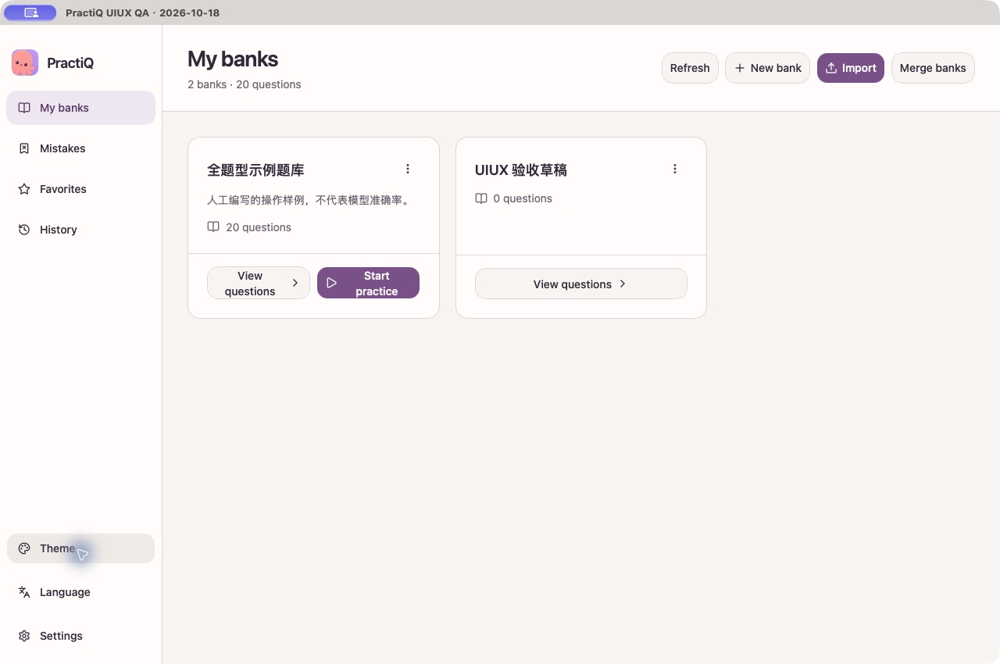
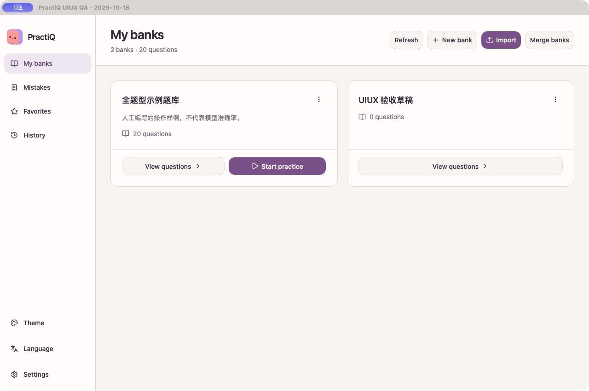
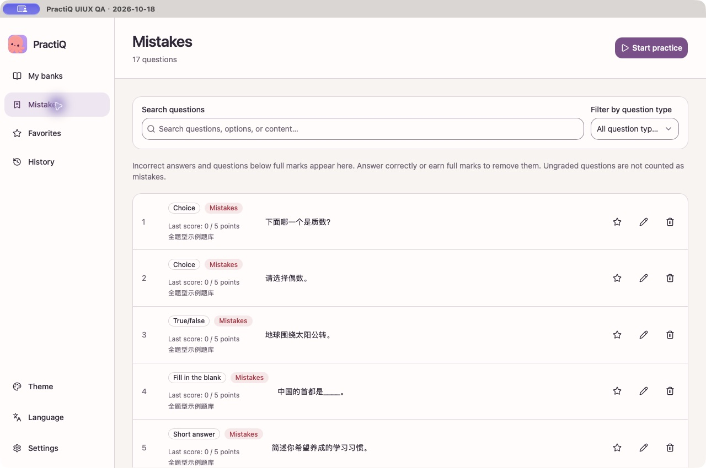
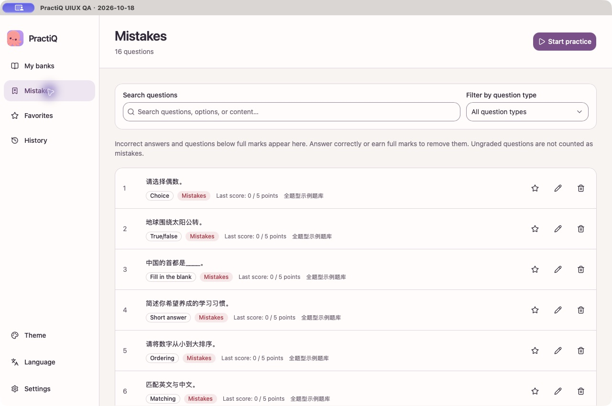
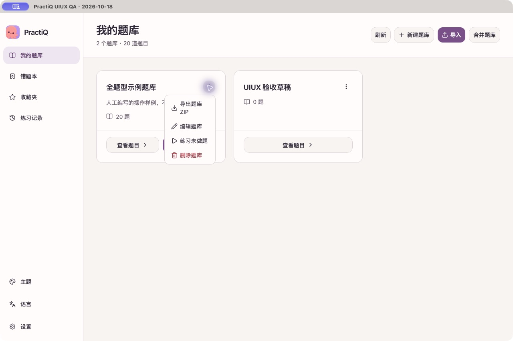
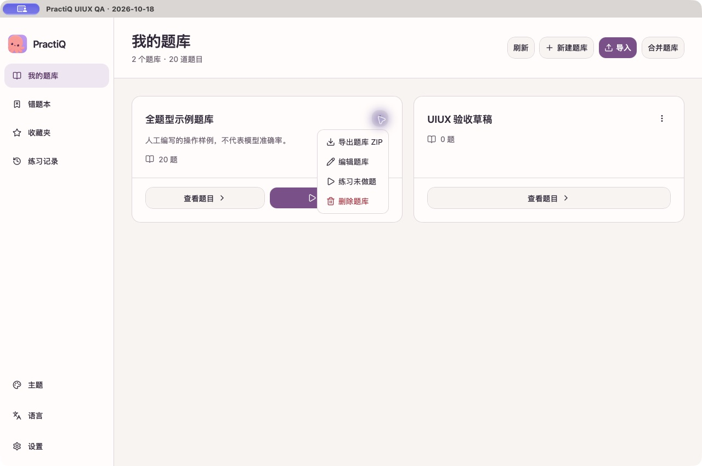

# Localized app layout acceptance — 2026-10-18

The screenshot review found cramped English bank actions, a bank export menu that split `ZIP` onto its own line, a truncated English type filter, and question stems whose starting position depended on the metadata width. Restore-menu descriptions shared the narrow-menu problem.

Bank columns now follow available content width, and footer actions wrap as whole buttons. Dropdown menus fit their content within the viewport. Question lists lead with the stem and put wrapping metadata below it. The type selector has room for English labels; the search field retains a minimum width so active filters wrap instead of squeezing its label. Long English actions retain vertical padding.

## Native screenshots

These screenshots come from the isolated `com.practiq.uiux-20261018` macOS QA app using WKWebView, real Tauri commands and synthetic SQLite data. They are 1280×850. Before/after mistake counts differ because an earlier acceptance session answered one item correctly; this layout change does not modify stored answers.

| Surface | Before | After |
| --- | --- | --- |
| Bank actions |  |  |
| Question lists |  |  |
| Bank menu |  |  |

## Validation

- The earlier full acceptance set contains 112 macOS images. All were reviewed through contact sheets, full-size affected/control-heavy views and shared component source; their original SHA-256 hashes remain unchanged. The local follow-up gallery contains 31 native captures across Chinese/English and light/dark themes, including five final-build confirmations.
- The source unit suite passed: 415 tests passed, one skipped. Statement/branch/function/line coverage was 89.84% / 85.28% / 87.50% / 93.31%.
- All 102 app browser tests passed, including 16 new locale/theme/width combinations. Geometry assertions cover label lines, button containment and height, menu viewport bounds, focus restoration, filter truncation and stem alignment. Existing checks cover active-filter errors, editing guards, rich content and 360px/390px touch navigation.
- TypeScript, ESLint and the macOS debug bundle build passed. The layout detector reported no findings.
- No live model calls were made. Windows native acceptance, an updated Android native build, signing and clean-machine installation were not performed locally. Browser mocks do not establish native Android behavior or remote CI success.

Colors, native commands, local data, backup compatibility and explicit model-call boundaries are unchanged. The principal tradeoff is that narrow desktop windows show fewer bank columns to preserve readable actions. Local screenshot evidence is separate from the PR's current-head CI and review evidence.
