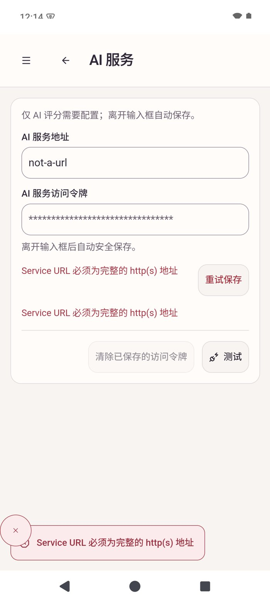
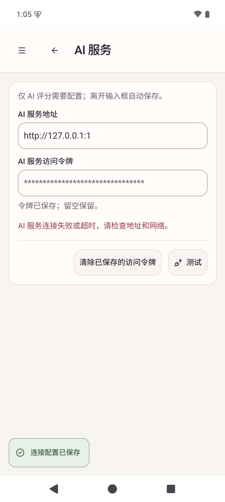
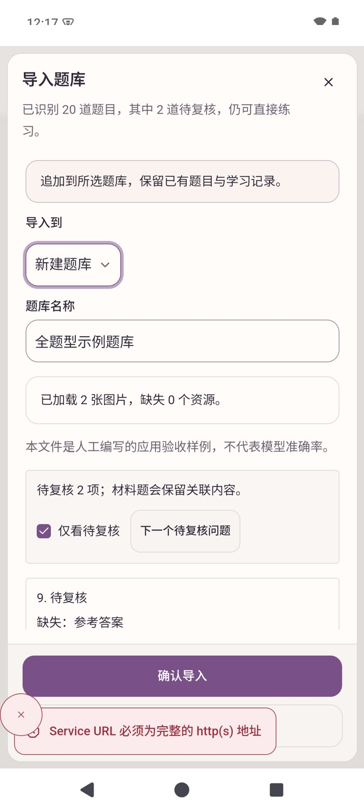
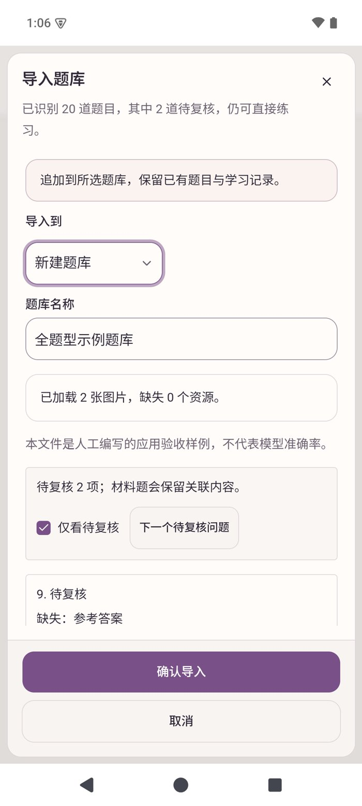

# Full screenshot review and service feedback acceptance

## Review scope

The 2026-10-18 acceptance set contains 1,087 images: 112 native macOS, 95 native Android, 316 import Web and 564 app browser images. Every image was screened, deduplicating identical SHA-256 images within each platform group: 112 / 93 / 269 / 457 unique images respectively. Every original file still matches its manifest hash.

The review used contact sheets for whole-surface screening, full-size inspection of affected and control-heavy views, shared component source, and follow-up interaction checks. It covered navigation, bank/question management, import/export, practice/exams, scoring, settings, backups, empty/error/recovery states, rich content, localization and themes represented in the set. This is review of the saved corpus, not proof of every possible future state or formal accessibility certification.

Local evidence is retained under `docs/evidence/2026-10-18-complete-uiux-audit/`: `screenshot-audit.csv` maps every original and duplicate, `audit-summary.json` records counts/hash verification, and `index.html` links the 52 new contact sheets and previous eight macOS contact sheets. Large original galleries remain local rather than adding them to Git.

## Findings and changes

| Finding | Resolution |
| --- | --- |
| English bank actions wrap inside cramped buttons; export ZIP and restore descriptions wrap unnecessarily; type filters truncate; variable metadata shifts question stems | [PR #274](https://github.com/shenyankm/PractiQ/pull/274), with [native layout comparisons](ui-layout-20261018.md) |
| Connection testing repeats a save failure in the form, test result and persistent toast; test errors survive navigation and obscure later Android import actions | Keep save failures beside the draft and connection failures beside Test; remove redundant persistent error toasts |
| Failed credential clearing is reported only in a floating toast | Show the failure beside Clear; preserve the saved configuration and allow explicit retry with the same action |
| Some custom Web catalog captures show the lazy-review loading fallback; some browser captures show animation intermediates or the development preview panel | Evidence limitation, not a confirmed production defect. Other settled result-review captures and existing interaction assertions cover the rendered content. Do not treat loading snapshots as complete result-page acceptance |

The existing global window-close failure notification remains available when no inline form is visible. Diagnostics, explicit retry, token protection, draft preservation, database schemas and model-call boundaries remain unchanged. No dependency was added.

## Native comparisons

The Android captures use the existing isolated API 35 arm64 emulator and synthetic SQLite bank. The updated debug APK uses real Tauri commands and Keystore. The network failure targets `http://127.0.0.1:1`, with a synthetic placeholder token; no model endpoint is called. Import preview is reached through the real system picker and cancelled without importing duplicate data.

| Before | After |
| --- | --- |
|  |  |
|  |  |

The rebuilt isolated macOS app also confirms one pre-test save error, the invalid address draft, Retry save, correction and subsequent restore-menu navigation. Its network-error retest blocked inside the system Keychain password read; process sampling and the waiting screen are retained locally. No Keychain permissions were changed and that retest is not counted as passed. Failed credential clearing is covered with substitutes, not a deliberately broken native credential store.

## Local validation

- TypeScript, ESLint and app unit coverage passed: 417 tests passed, one skipped; statement/branch/function/line coverage 90.10% / 85.48% / 87.68% / 93.57%.
- The complete app browser suite passed all 106 tests, including built touch navigation, rich content, draft guards and the four new service-feedback scenarios.
- Four focused browser scenarios passed at 1280px and 390px, light and dark. They assert a single inline connection error, no persistent error toast, unobscured import confirmation after navigation, failed-clear retry, and exactly one test/two explicit clear calls.
- A fresh Web catalog passed all 44 passive scenarios: 11 task states at 1440px/390px in light/dark themes. Captures wait for the lazy result view to finish and, where applicable, assert the rendered question. The new gallery retains these settled captures alongside the original loading intermediates; mocked mutation and model-start counts remain zero.
- Focused regression tests failed on the original behavior and passed after the fix. They cover failed save before testing, preserved token drafts and failed-clear recovery without a network test.
- macOS debug bundle and Android arm64 debug APK built successfully. These local QA builds omit package resources and are not distribution artifacts; remote platform CI validates complete packages separately.
- The layout detector reported no findings. Original screenshot hashes were verified after the review.

Remote CI and automated code/security review are separate, current-head gates before merge. Physical Android devices, Windows native acceptance, minimum Android OS/WebView, release signing, clean installation and live models are outside this local UI check.
