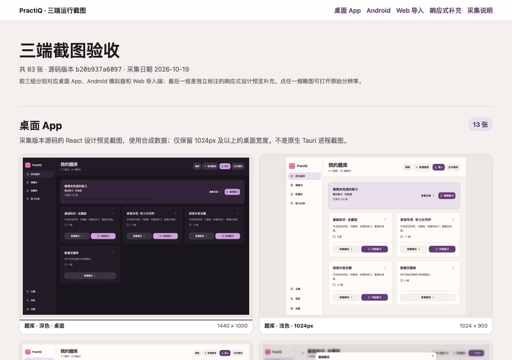
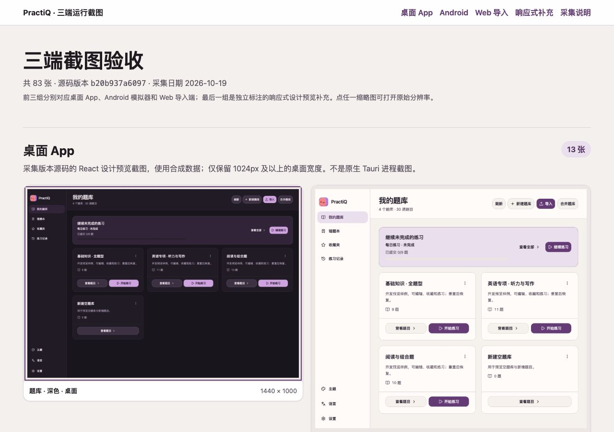

# Gallery follow-up: priorities 4–5

Implemented and accepted on 2026-10-19. This change is independent of App PR #307 and starts from main (`58b726f1`). It publishes the existing historical source gallery and its 83 screenshot assets alongside the focused layout/label changes. The screenshots still represent the explicitly recorded capture version (`b20b937a`), not the latest App implementation. Unrelated local evidence is excluded.

## Changes

- Give desktop landscape screenshots wider columns and a matching aspect ratio, retaining portrait preview sizing for Android/Web.
- Offset anchor scrolling for the sticky header at desktop and narrow widths.
- Give all 13 desktop entries readable Chinese page/state labels and retain every original-image link.
- Label Android AVD captures as emulator runtime evidence; distinguish React previews from APK execution and label the source as the captured version rather than current code.
- Preserve the existing palette, typography, original screenshots and native-image opening behavior. No viewer/lightbox, dependencies or other features added.

## Evidence

| Check | Before | After |
| --- | --- | --- |
| First landscape image, 1280px viewport | 266 × 184.72px actual rendered content | approximately 565.99 × 393.05px |
| Desktop anchor title / header bottom | y=29.30 / 53px (covered) | y=109.30 / 53px (visible) |
| Narrow anchor title / header bottom | y=29.19 / 133px (covered) | y=173.19 / 133px (visible) |
| Images and links | 83 | 83, original paths unchanged |
| Original image hashes | Recorded | All 83 verified unchanged |
| Horizontal overflow at 1280 and 390px | None | None |

- [Before desktop](before-1280.jpg) / [After desktop](after-1280.jpg)
- [Before narrow](before-390.jpg) / [After narrow](after-390.jpg)
- [Browser measurements](browser-checks.json), including Android/Web/responsive anchor positions.
- [Image preservation](image-preservation.json), [targeted detector](design-detector.json), [reviewable source patch](gallery.patch).

The mechanical scan returned zero findings. This validates the static gallery, not the behavior or freshness of the original App screenshots. No native runtime, device or model call was exercised. The source remains available on the existing loopback gallery server at `http://127.0.0.1:8765/index.html?gallery=responsive-split#desktop`.

## Review and publication

The gallery was previously untracked, so Git presents it as new files. [gallery.patch](gallery.patch) isolates the actual optimization against the preserved [original HTML](before-index.html) and [original notes](before-README.md). The original HTML is a raw source snapshot; use the before/after JPEGs for visual comparison.

The service-settings screenshot was visually checked: the address and token fields are obscured. Metadata contains synthetic fixture details and capture provenance. No credentials or databases are included. The original warm palette is intentional and retained under the user’s instruction to preserve the existing visual style. The previous cream-palette hook finding concerned generated App test output, not a new gallery regression; its existing narrow exception remains local and is not added to this PR.

## PR review follow-up

All three findings in [review 5571370973](https://github.com/shenyankm/PractiQ/pull/308#pullrequestreview-5571370973) were confirmed and fixed after the initial acceptance above:

- Both capture manifests now consistently describe the captured-version Android runtime, with the original source commit and image hashes retained.
- Thumbnail focus uses an inset outline (`outline-offset: -4px`), while ordinary navigation links retain their outer outline.
- Desktop images use `aspect-ratio: auto 36/25` so loaded images retain their intrinsic ratio. At 1280px the 1024×900 image now renders at 566×497.45px rather than 566×393.05px with side gutters; the 1440×1000 image remains 566×393.05px.

The browser was exercised using keyboard Tab from the collection-notes link to the first thumbnail at 1280×900 and 390×844. The complete inset focus outline is visible; both intrinsic image ratios match their rendered boxes; neither viewport has horizontal overflow. [Measurements](review-fixes/browser-checks.json) record the focus state and image dimensions. Python assertions rechecked both manifests for stale `current` wording, all 83 original hashes, both focus offsets and both image ratios at both widths.

| Before review fixes, 1280×900 | After review fixes, 1280×900 |
| --- | --- |
|  |  |

[Narrow keyboard acceptance](review-fixes/after-focus-390.jpg). These are static-gallery checks; no new native, device or live-model acceptance was performed.
