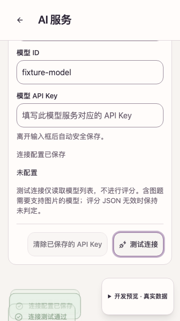
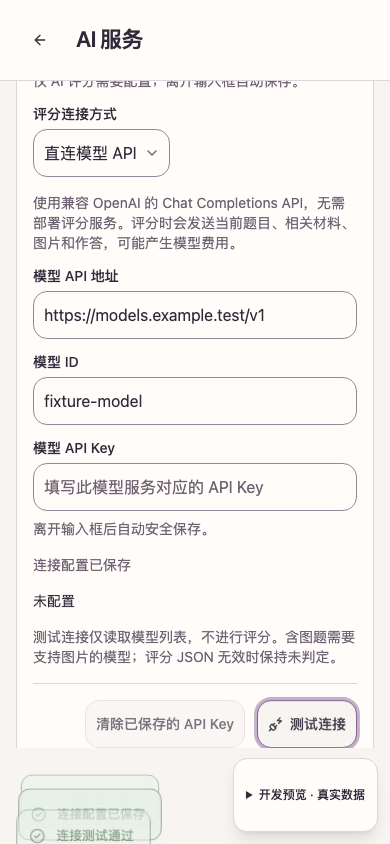
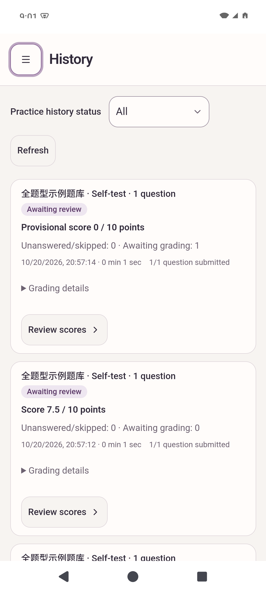
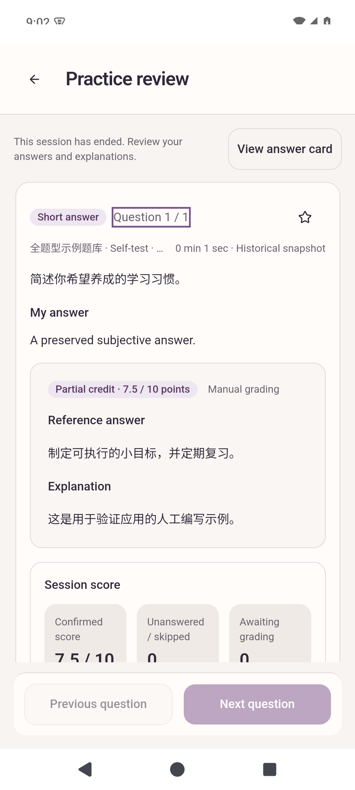
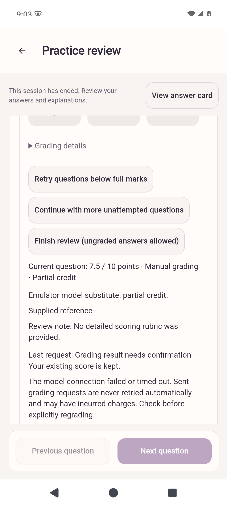

# Direct model grading: local acceptance, 2026-10-20

The app calls an OpenAI-compatible Chat Completions endpoint through the existing Rust reqwest client. The arm64 Android Debug APK built, passed strict package checks, installed, and passed the native grading and credential regressions on an isolated emulator. No real model or paid service was called.

The APK was built and tested from the local working tree before the feature commit. [Source hashes](candidate-sources.json) identify its changed implementation and test files; [the package report](android-package.json) identifies the actual APK independently of the Git base commit.

The later connection-test review fix has separate [follow-up regression evidence](pr-330-follow-up.md); the APK hash below identifies the original pre-review build.

## Results

| Check | Result | Evidence |
| --- | --- | --- |
| Shared contracts and fixtures | Passed; 49 contract cases | [App checks](app-check.txt) |
| App TypeScript, lint and unit tests | 451 passed, 2 existing opt-in tests skipped | [App checks](app-check.txt) |
| Host Rust tests, formatting and Clippy | 205 passed, 16 existing opt-in tests ignored; no Clippy warnings | [App checks](app-check.txt) |
| Frontend coverage | Statements 90.58%, branches 86.15%, functions 87.84%, lines 93.68% | Local `app/.build/direct-grading-ui-coverage.log` |
| Complete desktop/bilingual/touch browser suite | 117 passed | [Full browser log](all-browser.txt) |
| Touch/browser regressions | 24 passed at 360px and 390px, including production navigation | [Browser log](android-browser.txt) |
| Kotlin credential rules | 4 passed | [JUnit XML](android-unit.xml) |
| Android instrumentation | 18 passed across grading, Keystore and the private bridge | [Instrumentation log](android-instrumentation.txt) |
| Android package | Passed; arm64-v8a, version 0.2.0, minSdk 26, targetSdk 36; no embedded AI engines | [Package report](android-package.json) |
| Process restart and SQLite persistence | Schema 11; manual 7.5/10 retained with all three model receipts | [Restart check](restart-persistence.json) |

Machine-readable results are in [checks.json](checks.json).

## Native grading acceptance

`DirectGradingTest` uses real native IPC, Rust HTTP, Android Keystore and SQLite. Its model substitute is a bounded HTTP server on emulator loopback; the frontend does not fabricate grading results. The test uses only synthetic question banks and a dummy key.

The [native receipt](native-grading.json) records exactly three explicitly requested model calls and one read-only model-list check:

1. Configuration saves and passive reads make no model call and never return the key. Connection testing reads `/v1/models` once.
2. Explicit grading sends the frozen question and answer to `/v1/chat/completions`, validates JSON, and records 6/10 with supplied usage.
3. Checking that request returns the local receipt without another HTTP request.
4. Explicit regrading with invalid scoring JSON preserves 6/10 and records an ungraded result.
5. Explicit regrading followed by a connection drop preserves 6/10 and records an unknown result. Checking it again, clearing the key and checking, and recreating the Activity and checking all leave the model-call count at three.
6. Manual review records 7.5/10; further AI grading is rejected. A separate question without a reference answer or rubric is also rejected before model work.
7. Explicit key clearing removes the credential. A new request requiring credentials fails with `LOCAL_MODEL_KEY_REQUIRED`.

After force-stopping and reopening the app, the saved attempt still has `earned_cents=750`, `grade_kind=manual`, and ordered `graded`, `ungraded`, `unknown` request receipts. The current unknown request and the earlier AI result remain available for review. No database or credential files are included in this evidence directory.

Additional Rust regressions cover source-score conversion, zero credit versus abstention, strict output validation, response bounds, redirects, reflected-secret redaction, changed grading targets, immutable snapshots and interrupted-request recovery. Existing service-mode tests continue to pass.

## Android candidate and environment

- APK: `app/src-tauri/gen/android/app/build/outputs/apk/arm64/debug/app-arm64-debug.apk`.
- APK size: 75,697,095 bytes (75.70 MB); SHA-256 `ae7d429a7199e9461de488f14fb591b2a4979cf799474d6ee8f011b39274f5eb`.
- Native-library SHA-256 `e728f9964b6c3c51584aba24489f794f85a9168c3e1a01e3f8a067f48492d8e9`.
- Fresh isolated AVD `PractiQ_Grading_QA_20261020`, serial `emulator-5580`, Android 15/API 35, arm64-v8a, WebView 124.0.6367.219. Existing AVDs and their data were not modified.
- macOS arm64 host, Python 3.14.7, NDK 28.2.13676358, SDK/build-tools 36, Gradle 8.14.3. Local builds used the available OpenJDK 17.0.20.1; the documented JDK 21 environment was not separately checked.
- Debug information and incremental Cargo output were reduced through environment variables to fit available disk space; no product profile or dependency was changed.

The normal APK build used Tauri CLI after the frontend build, Android runtime inventory export, and package-notice preparation described in [the Android guide](../../../app/docs/android.md). Tests reused that compiled native library through `-x rustBuildArm64Debug`, with `abiList=arm64-v8a`, `archList=arm64`, and `targetList=aarch64`. Instrumentation was run directly with adb to retain the isolated installation and its synthetic records.

## Resolved verification failures

- Initial build attempts exhausted disk space or lacked the generated frontend assets. Only this worktree's generated build output was cleaned; the final builds use the real production frontend and verified package resources.
- Clippy rejected a now test-only convenience method. It is explicitly compiled only for tests.
- An early touch-navigation run was interrupted by Vite reloading while Android build files changed. Its trace showed a new page load. The stable-source rerun passed all 24 checks without increasing waits or changing the navigation assertions.
- Java's Maven TLS connection failed while fetching uncached test dependencies. Fixed-version artifacts were fetched over verified HTTPS from the same official Maven Central/Google Maven repositories, checked against their published SHA-1 values, and supplied through a task-local repository for the instrumentation build. [Google artifact SHA-256 records](test-dependency-downloads.json) are retained. Maven Central's hamcrest-library 1.3 JAR SHA-256 is `711d64522f9ec410983bd310934296da134be4254a125080a0416ec178dfad1c`; its POM SHA-256 is `1ceb4bfb0f098ae29b935044b2363e11323313fe3ed2055df8b79737d5056277`. Dependency versions and lockfiles were unchanged; runtime TLS checks were not weakened.
- New native test preparation was corrected to await the WebView, select an explicit bank, and submit exam drafts through the existing `save_draft`/`submit_paper` contract.
- The first combined instrumentation run launched separate Activities for two test classes and crashed in native teardown. Both classes now reuse the existing process-owned Activity fixture. The final combined run passed all 18 tests. First-run logs remain under local `app/.build/direct-grading-*`; the final successful outputs are retained above.
- Local receipt checks were moved before credential access, so checking a saved result works after the API key has been cleared.

## Scope and limits

This establishes local Debug APK/package acceptance, emulator-native transport/storage/lifecycle behavior, and browser UI behavior with substitutes. It does not establish model grading accuracy, a real-provider compatibility matrix, physical-device or minimum-Android acceptance, Windows-native behavior, remote CI, or signed-release acceptance. The independent document-import service was not changed or exercised. The 16 ignored Rust tests and two skipped frontend tests were not enabled for this run.

Connection settings and optional model configuration reuse the versioned sidecar and backup recovery. API keys have a separate native credential namespace and are excluded from backups. The practice schema remains 11. Older App versions reject settings sidecars and backups carrying the new optional model configuration; continue using the current App after enabling it.

## Screenshots

These are synthetic browser settings checks, with a dummy key cleared before capture:

| 360px touch layout | 390px touch layout |
| --- | --- |
|  |  |

The installed APK after a full process restart retains the manually reviewed score and the failed request alongside the earlier AI result:

| Native history | Native answer review | Native grading details |
| --- | --- | --- |
|  |  |  |
