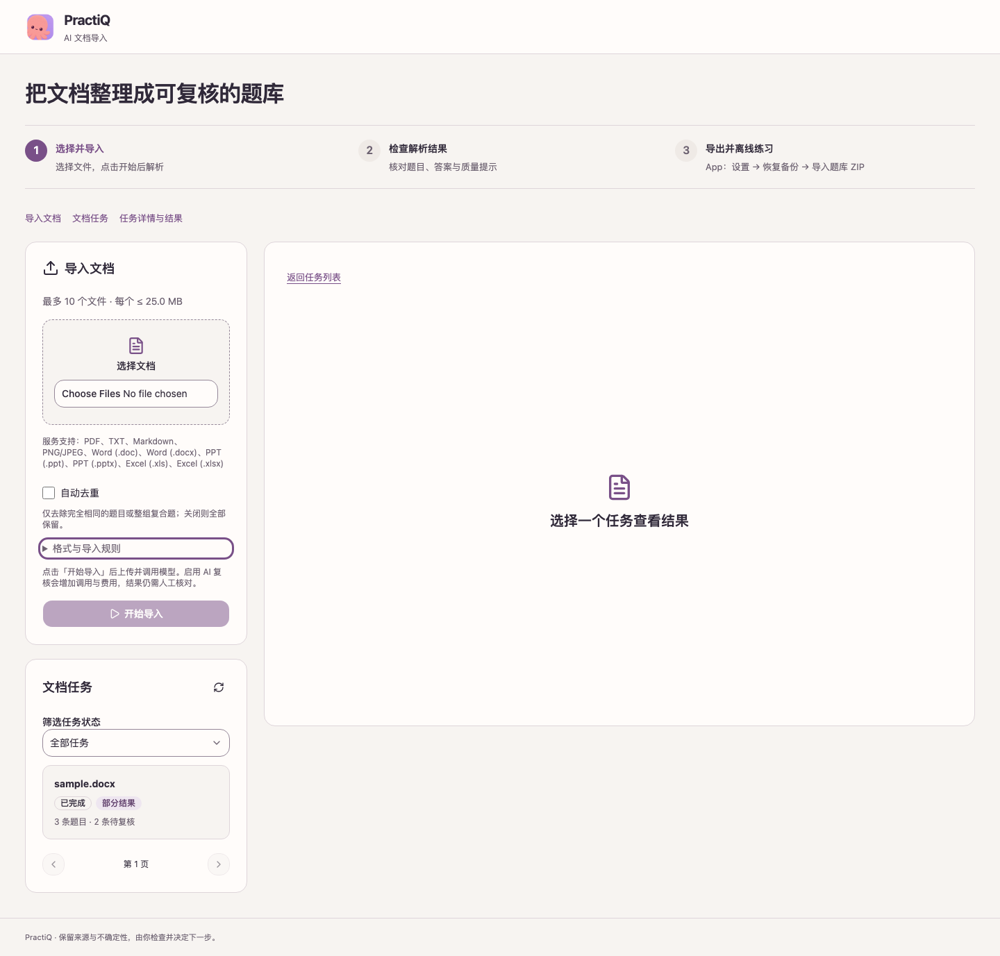
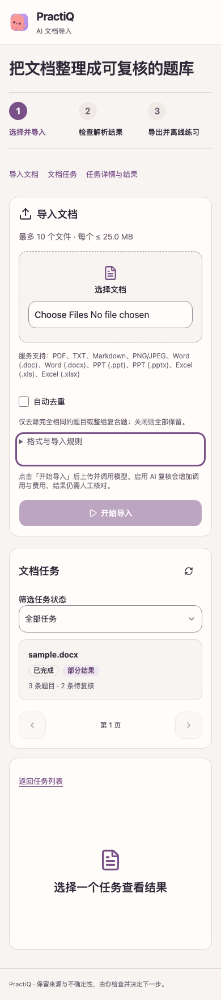

# Tencent parser review and acceptance — 2026-10-20

This change routes recognition through Tencent asynchronous document jobs while retaining local source/result storage and the existing explicit model-work boundary. The service is a personal, single-process deployment.

## Review fixes

- Accept the optional COS transport ceiling in the Web client and serialize its pre-submission `STAGING` state through the shared detail contract.
- Decode Tencent native workbook tables without inventing OCR dimensions. Retain field/cell evidence and uniquely matched XML layouts for merged spans. The original direct submission omitted a hidden sheet. Follow-up preparation exposes hidden sheets in a derived copy; the live retry returned both sheets, and production preparation matches the submitted SHA-256. Excel retains fidelity review flags.
- Keep OCR JSON in authenticated source review, outside bank ZIP image resources. A failing regression reproduced `Unsupported packaged resource media type` before this fix; partial export now retains its failed-unit marker and local evidence.
- Preserve sanitized Tencent request IDs on explicit submission rejection without retaining provider error text or automatically resubmitting.
- Remove unused page-image caching, model figure verification and their obsolete tests/fakes. Update checkpoint benchmarking, browser acceptance fixtures and English/Chinese configuration/import guidance.

- Follow up all five PR findings: preserve hidden sheets, retry COS deletion through an incomplete prepare checkpoint, advertise usable Office limits, remove legacy Office modes only from reparse children, and reject legacy CSV reparse with a controlled 422 while retaining saved tasks.

- Second review: bound direct Office paid pages, disable futile terminal Resume actions, convert CMYK tiles safely and require unchanged concatenated text for original-source proofs. The oversized XLSX concern was checked against the existing `SinglePageSheets` export: Docker LibreOffice 7.4.7 returned both sheets and hidden content from the original workbook.

## Local validation

All commands ran on macOS arm64 with the existing Python 3.14.7 interpreter; no project virtual environment was created. `AI_PYTHON` selected that interpreter and `PYTHONPATH` selected this worktree's `server/src`.

| Check | Result |
| --- | --- |
| `make verify AI_PYTHON=<existing Python 3.14.7>` | Passed: 2,877 tests, 92% coverage, Ruff, Pyright, evaluation fixtures, recovery probes and source/wheel package checks |
| `make web-check` | Passed: 103 unit tests and 32 Chromium checks, including passive selection, explicit submission, uncertain mutation recovery, review, export, keyboard focus and responsive layouts |
| `make web-build` | Passed |
| `app/scripts/export-contracts.py --check` | Passed |
| `app/scripts/check-fixtures.py` | Passed: 49 shared contract cases and the sample |

Service tests use disposable PostgreSQL/RabbitMQ and provider substitutes; they make no external model calls. Earlier full runs were stopped to repair review findings; the final full run completed successfully. Local logs and detailed reports remain outside the committed evidence.

## Live recognition and limits

[Sanitized API outcomes](live-recognition.json) cover repository-authored TXT, PDF, DOCX and XLSX fixtures. Each completed through Submit/Describe, bounded archive download and decoding; TXT used `ResultType=2`, while layout/workbook inputs used `ResultType=9`. The original synthetic workbook response supplies the small JSON/XML regression fixtures in `server/tests/fixtures/tencent-xlsx.*`.

These were Tencent recognition calls and may consume quota or incur charges. No question-structuring or grading model was called; neither API success nor archive decoding proves question accuracy. COS was tested with substitutes only because its bucket and region remain intentionally unset. Real-document accuracy, PPT and other untested live format cases still require deployment acceptance. Native installers/devices were not rebuilt in this review. Remote CI, code/security review and merge state remain separate gates.

## Browser evidence

The screenshots use synthetic authenticated HTTP responses, not a live provider or native app.

