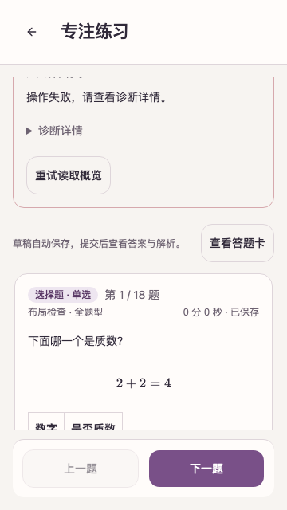
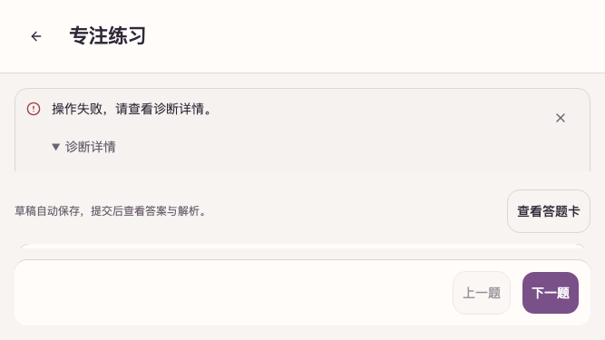
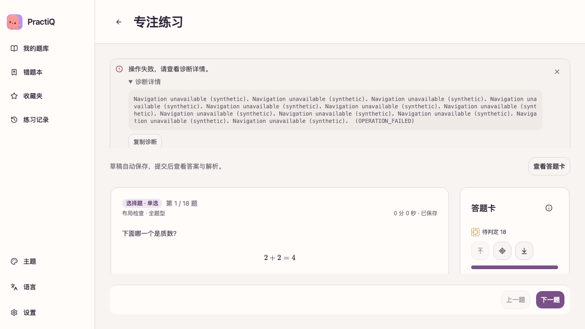

# PR #334 review follow-up

This supplements the [original 470-image gallery](../2026-10-21-uiux-fixes/README.md).
The original capture provenance remains historical; these screenshots cover the
practice error-recovery fix added after review.

## Findings addressed

- Practice notices now take space from a flex workspace rather than pushing a
  full-height session below the clipped viewport. Expanded diagnostics scroll in
  a bounded notice group; the footer and remaining question scroller stay reachable.
- Ordering item IDs fall back to their zero-based positions. Matching IDs use
  zero-based positions independently within each side, matching
  `answer_references_missing` in the server contract. Explicit IDs still win.
- Empty fill-blank, ordering and matching answer arrays show an explicit empty
  reference message. Original records and nulls remain unchanged.
- Partial choice, ordering and matching answers retain supplied values alongside
  explicit missing-value placeholders, including null list entries and missing
  sides of a matching pair. Raw records remain unchanged.
- Image-size actions retain their changing action labels without `aria-pressed`,
  so the accessible name does not contradict the current image-size state.

The initial App and service CI failures were caused by Vite's bundled
launch-editor advisories. Both frontends now use Vite 8.3.4, with regenerated
lockfiles. See the [Vite release](https://github.com/vitejs/vite/releases/tag/v8.3.4)
and [advisory](https://github.com/advisories/GHSA-r825-w8mm-5pxw).

## Local validation before push

- App `npm run check:ui`: 460 passed, 3 existing skips.
- Web `npm run check`: 163 passed, including positional/explicit/mixed item IDs,
  independent matching-side positions, empty and partial arrays, and source immutability.
  Six added regression cases failed before the implementation fix.
  Five partial-answer cases also failed before the subsequent null-preservation fix.
- App Playwright `--project=preview --grep 'practice error recovery'`: 3 passed
  at 360x640, 667x375 and 1280x720. All three failed before the layout fix.
  Each verifies collapsed/expanded diagnostics, positive content-scroller height,
  footer bounds, keyboard reachability and a successful explicit navigation retry.
- Both frontend `npm run build` commands passed.
- Both frontend `npm audit --audit-level=high --json` commands passed with zero
  vulnerabilities. No audit threshold or ignore list changed.

Remote CI and review results are recorded on [PR #334](https://github.com/shenyankm/PractiQ/pull/334).
These are Chromium previews with synthetic native responses, not physical-device,
system-picker/keyboard or live-service acceptance. Screenshot hashes and byte sizes
are in [capture-integrity.json](capture-integrity.json).

## Subsequent dependency-audit gates

After the frontend audit passed, CI reached two previously blocked audit stages:

- Python: update Pillow 12.3.0 to 13.0.0 and locked certifi 2026.7.22 to
  2026.10.19. Only these two locked Python package versions changed. The
  [Pillow release notes](https://pillow.readthedocs.io/en/stable/releasenotes/13.0.0.html)
  describe its security fixes and removals; affected image paths passed 257 local
  tests across Tencent input normalization, page rendering, figure cropping,
  extraction environment, bank export and document handling.
- Rust: update rustls-webpki 0.103.15 to 0.103.16 and webpki-roots 1.0.9 to
  1.0.10 for [RUSTSEC-2026-0382](https://rustsec.org/advisories/RUSTSEC-2026-0382.html)
  and [RUSTSEC-2026-0381](https://rustsec.org/advisories/RUSTSEC-2026-0381.html).
  These patches reject/remove the distrusted emSign certificate paths.

`uv lock --check`, `make audit` and `make audit-rust` passed using the existing
Python 3.14.7 interpreter. Both Python audit sets report no known vulnerabilities;
Rust retains its six existing allowed warnings, with no audit configuration or
threshold changes. All five supported native dependency graphs pass the existing
GLib reachability guard. Native macOS Rust library tests passed (209 passed,
16 existing ignores); new-head CI continues separately.

The recovery matrix also retains a failing overview read while navigation fails.
Before grouping notices under one shared height cap, two narrow-screen cases
still clipped the footer (360x640 and 667x375). All practice notices now share one
bounded scroller, so their combined height leaves space for the practice session.

The combined-notice fix passed the 24-case layout matrix and all three recovery
cases, including keyboard access to the overview retry action. App types, lint,
460 tests (3 existing skips) and production build passed again. Follow-up images
and their metadata now reflect this combined-notice state.
