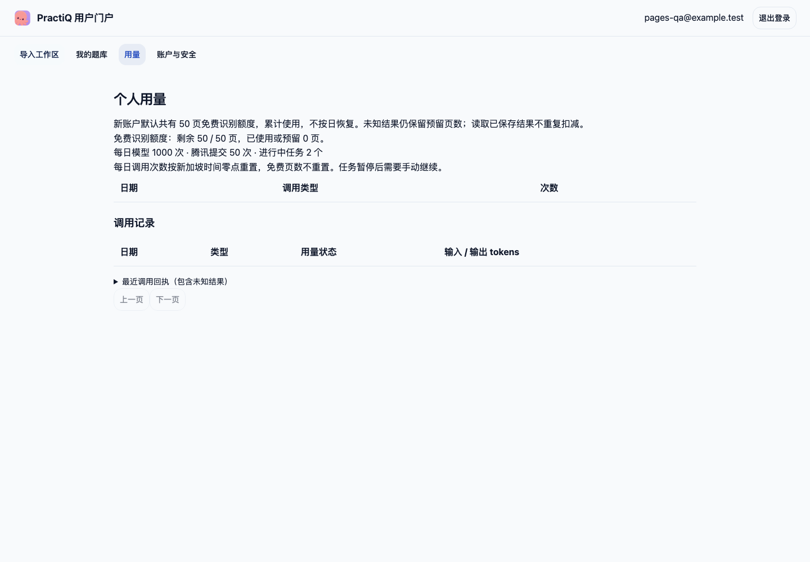

# User portal acceptance

The screenshot shows a newly registered synthetic account with 50 lifetime free
recognition pages and zero used/reserved pages. It was captured from a loopback
service using disposable PostgreSQL/RabbitMQ and the built Web assets on macOS.
No real document or paid provider was used.

The same browser flow explicitly changed the account's total allowance to 75 from
the administration area, then signed in again and verified the updated balance.
No browser page errors occurred. Automated checks also cover exhausted balances,
CSRF, session revocation, cross-user denial, atomic reservations and unknown calls.
This is engineering evidence, not production or independent user acceptance.
