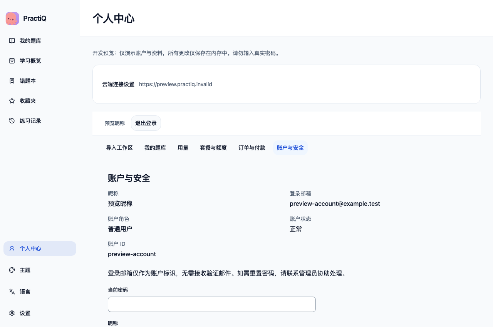

# Native account acceptance — 2026-11-08

## Environment

- Local macOS App built from the working tree, using Tauri `build --debug --bundles app`. The frontend is the production Vite build, without preview data or mocked IPC.
- Isolated identifier: `com.practiq.acceptance.account20261108`; its practice directory and Keychain service are separate from the normal App.
- Real Uvicorn account APIs on `http://127.0.0.1:18090`, a fresh schema-8 PostgreSQL database and dedicated local storage. Dedicated PostgreSQL and RabbitMQ containers use loopback ports.
- `AI_READ_ONLY=1` and `ALIPAY_ENABLED=false`. No provider credentials were configured. Document processing and RabbitMQ delivery were not exercised.
- An operator explicitly initialized the database and bootstrapped an administrator through the management command. The native UI registered a separate ordinary user; no session or customer account was preseeded.

## Observed native flows

| Flow | Result |
| --- | --- |
| Connect through Personal center | Passed; native connection to the real loopback service |
| Register an ordinary user | Passed; profile shows email, role, enabled state and account ID |
| Change nickname with current password | Passed; server profile and sidebar display the saved name; password fields clear |
| Read usage and plans | Passed; lifetime free allowance is 50 pages, used/reserved is 0; payment actions are disabled |
| Log out and log in again | Initially failed with `CLOUD_ACCOUNT_CHANGED`; passed after the connection-context fix below |
| Revoke the active session through Account and security | Passed; server revocation causes the App to return to login with an expired-session message |
| Log in explicitly after revocation | Passed; original credentials restore the same profile |
| Quit the process and reopen the App | Passed; the old process exited, and a new process restored the same account without password entry |
| Finish with logout and open local banks | Passed; no login gate blocks local-bank navigation |

## Failure found and fixed

The sidebar and account page originally held separate native connection contexts.
After logout, each session GET could rotate the anonymous cookie and native
generation. The sidebar's later GET left the account page with a stale generation,
so its next explicit login was correctly rejected by the native fence.

Both readers now reuse the current origin's native bridge. Explicit origin
configuration still creates a fresh bridge, and native stale-origin/account
checks remain intact. No mutation is automatically replayed.

`AccountEntry.test.tsx` now rotates anonymous generations and enforces generation
checks on other requests. The regression fails against the old implementation
and passes with the fix. The native-IPC browser substitute also enforces these
checks and exercises logout followed by login.

## Independent state checks

Queries read only safe account fields and aggregate counts. Keychain checks used
entry metadata, without reading the credential value.

| Check | Signed in / after restart | Final logout |
| --- | --- | --- |
| User role / status | `user` / enabled | Unchanged |
| Password storage | Argon2id hash | Unchanged |
| Lifetime free allowance | 50 | 50 |
| Active server sessions | 1 | 0 |
| Origin-bound native Keychain entry | Present | Absent |
| Provider-call records | 0 | 0 |
| Document tasks | 0 | 0 |
| Grading records | 0 | 0 |

No authentication secrets are included in this record.
After final logout, the dedicated service and containers were stopped. Their
isolated database and storage were retained; normal App data was not modified.

## Automated checks and limits

- `VITEST_MAX_WORKERS=2 npm --prefix app run check:ui`: types and lint passed; 591 tests passed, 6 skipped.
- `npm --prefix app run test:browser -- --project=cloud-native --project=preview --grep 'account entry|account connection|App keeps offline'`: 6 passed, including the stricter native-generation substitute.
- Native App packaging passed after the fix; the real-account flows above were repeated in that new bundle.
- Public HTTPS/reverse-proxy behavior, production accounts, password reset, provider calls and payments were not tested in this run. This was an isolated local account acceptance, not a signed release or production deployment.

## Submission follow-up

The final navigation uses a single-row Account entry with identity/status in its
accessible description and tooltip; the duplicate Cloud service entry is removed.
The grading-connection hint and current setup guides use Account as the entry.

The final navigation was checked in all three languages against built assets,
and the account/native-IPC browser flows were repeated. The real native account
lifecycle above predates this presentation-only follow-up; it was not repeated.

Submission checks passed: 591 component tests (6 skipped), 11 selected browser
tests and another native debug App package build. The browser command was
`npm --prefix app run test:browser -- --project=built-macos --project=cloud-native --project=mocked --project=preview --grep 'macOS|built|account entry|account connection|App keeps offline|trilingual sidebar|offline ZIP entry'`.

This screenshot uses simulated data and is visual evidence, separate from the
real native-account acceptance above.
