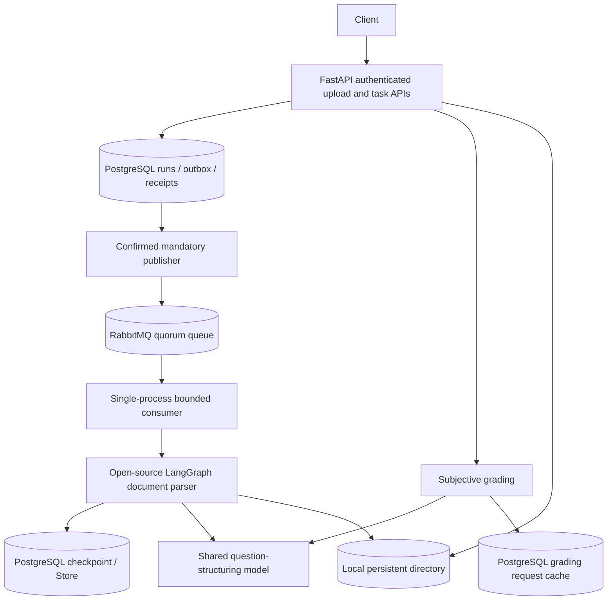

# Service integration and development guide

[Product overview](../../README.md) · [Simplified Chinese overview](../../README.zh-CN.md)

This guide covers configuration, document parsing, subjective grading APIs, and engineering checks for the independent AI service. For desktop instructions, see the [project overview](../../README.md). Commands run from the repository root unless stated otherwise. Historical reports describe only the versions they tested.

## Run locally

Use uv and an existing Python 3.14+ interpreter; do not create a project `.venv`. Copy the configuration template without overwriting an existing `.env`:

```bash
cp -n .env.example .env
```

### Native installation prerequisites

Installing the service from source with Python 3.15 requires native build
tools: the current lock has no compatible 3.15 wheels for `regex` and
`zstandard`, and other packages
may build from source depending on the platform and libc version. Install a
C/C++ compiler and linker, libc development headers, `make`, `pkg-config`, and
Rust 1.98.1 with Cargo before running `make install-locked`. The selected
interpreter must also provide its matching Python development headers; headers
for another system Python version do not suffice.

On Debian/Ubuntu, install the C tools with
`sudo apt-get install --no-install-recommends build-essential pkg-config`.
Install Rust 1.98.1 through the trusted host toolchain setup and make it
available on `PATH`. On macOS use Xcode Command Line Tools; on Windows use
Visual Studio Build Tools with the C++ workload and the matching MSVC Rust
target. Verify the selected platform's native installation; wheels are not
guaranteed for every supported interpreter/platform combination.

For a host without those build tools, use `make image-check` with Docker and
the Web build prerequisites instead. `Dockerfile.server` builds dependencies
in a digest-pinned `python:3.15-bookworm` image containing the C toolchain and
uses a separately pinned Rust toolchain. The production image is the slim
Python 3.15 runtime, includes libyaml for the compiled PyYAML extension, and
excludes compiler tools. Review all stage digests using
the [image-maintenance procedure](../../docs/maintainers/dependency-security.md).

### Configure and start

Provision an empty dedicated PostgreSQL database and its owner. Configure the service token, model, PostgreSQL URL (`DATABASE_URI`), dedicated RabbitMQ vhost URL (`RABBITMQ_URI`), and file storage in `.env`, then install locked dependencies, initialize the service tables and start:

```sh
make install-locked AI_PYTHON=/path/to/python3.14
make init-db AI_PYTHON=/path/to/python3.14
make web-install
make web-build
make server-dev AI_PYTHON=/path/to/python3.14
```

All model work uses the Responses API, fixed in code; there is no transport environment setting or Chat Completions fallback. Parsing, source review and App grading share this protocol. Requests explicitly send `store=false`, following the [OpenAI storage opt-out](https://developers.openai.com/api/docs/guides/migrate-to-responses#4-decide-when-to-store-state). Compatible provider endpoints must support Responses text, image and function inputs and accept this storage parameter. Existing function-calling schemas and local strict validation remain in use; `AI_STRUCTURED_OUTPUT_METHOD=auto` is equivalent to `function_calling`, while `json_schema` is rejected. Failures retain bounded retry, unknown-usage and explicit-recovery rules without switching APIs. Model HTTP clients refuse redirects and request `Accept-Encoding: identity`; configure the final endpoint directly. A content-encoded reply stops with `AI_RESPONSE_ENCODING` before decompression. Successful and error response bodies are limited to 8 MiB before JSON parsing. An oversized response stops with `AI_RESPONSE_TOO_LARGE`, keeps usage unknown and is not automatically retried; inspect provider records before an explicit retry. Finish tasks from an older deployment there or create new tasks; existing execution signatures are not rewritten.

Responses output must be completed. Token-limit truncation is rejected even when its tool arguments contain valid JSON. Its usage and durable receipt remain recorded, and `OUTPUT_TRUNCATED` stops the unit after that paid attempt instead of correcting the same source at the same output limit. Other schema/content failures retain bounded correction. Raw successful HTTP replies must contain nonnegative integer input/output token counts before SDK normalization. Both HTTP clients check Responses replies, including custom endpoint prefixes. Missing or invalid usage remains unknown. SDK failures raised before a model message is available, including a Responses `error` envelope, also remain conservatively unknown; inspect provider receipts before explicit recovery. Function-call IDs are excluded from repeated-invalid-output comparison, so new request IDs do not restart identical corrections.

Text fragments target 16 source question records when explicit numbered type labels and parent references prove complete, contiguous trees. Historical CSV fragments use the retained extractor's row-boundary evidence plus unique `id`, `root_task`, `parent_id`, `option_owner`, `question_type` and `stem` columns; extra columns remain source content. Recognized printed type labels and compatible parent/option-owner references are required. Implicit composite children and unknown or coded type labels retain the original splitting. Parents count as records. These fragments never split a tree or overlap, and each response must preserve the verified record count within the existing paid correction boundary. A single larger tree stays whole within the 40,000-character limit. The 16-record target is an initial output-density budget, not a provider capacity guarantee. Unknown, malformed or truncated layouts retain the previous character-based splitting and no count constraint. Leading section headings, inter-record directions and other text outside recognized local record fields also disable the density split, so a short document stays whole with its shared context. Historical CSV normalization preserves empty edge columns; embedded cell tabs/newlines disable this optimization. Later CSV fragments receive their header as separate model context, while artifacts and offsets remain exact source slices. Splitter, extractor and prompt changes are covered by the existing execution code fingerprint; resume old tasks on their original deployment.

For these verified source records, model IDs must match the current fragment's printed record IDs. A nonempty printed stem, explicitly supplied analysis, or proven local options must remain present in the parsed record; required local options need nonempty content in every entry. Shared-option children may retain empty local options. When the complete literal stem has an unambiguous field boundary, its UTF-8 hash also requires exact text after edge trimming, preserving labels, inline context, internal whitespace and punctuation. Inline English or Chinese answer/analysis labels with ASCII or full-width colons disable exact-stem hashing because the field boundary is ambiguous; nonempty-stem validation still applies. Clearly supplied, nonambiguous reference answers on known leaf records require a non-null answerPayload; parent, absent and uncertain answers remain ungated. This is presence validation, not a guarantee of answer correctness or completeness, and supported partial payloads remain reviewable. No missing content is filled. These checks apply during fresh parsing, stored-call replay and source review; persisted fragment hints and isolated validation context preserve the same boundary on explicit retry. Validation reports all known mismatches together so a correction can repair the whole fragment. Unverified layouts remain available as incomplete drafts. Duplicate candidates retain all parsed business fields and source context. Printed identity references are compared relatively only when unique source quotes and complete source/model parent, owner and blank relations prove a whole tree. Automatic removal additionally requires this verified original-source evidence for every node; image-only and unverified layouts remain retained for review even with the option enabled. All copies remain retained by default.

Typed-text duplicate proof additionally requires explicitly local serialized body fields, with option and item lines compatible with the declared question type. Unrecognized body text may carry shared section context, so it disables proof for the whole source unit without interpreting headings or changing extraction. Historical CSV fields retain their named row scope; new CSV imports are unsupported. Multiline or otherwise unrecognized prose therefore remains available for review and cannot authorize automatic removal.

Complete verified original-source trees are also compared separately to identify repeated source records whose parsed versions are not strictly identical. These matches only add a source-review warning and review flags to surviving copies; they never authorize removal. Explicit removal still uses the original strict business-field and source-evidence checks. Warnings and quality counts are rebuilt after any safe removal so they refer to the remaining copies.

The default address is `127.0.0.1:8090`. `GET /ok` checks liveness; `GET /ready` checks readiness. Writable local and production deployments require PostgreSQL and RabbitMQ. Read-only mode can serve existing state without the broker. Initialization accepts only an empty database and does not read or migrate old Agent Server data. A single service process holds an exclusive lock. Restarting reconciles eligible unfinished runs for broker redelivery; unknown paid-call results require explicit recovery. Manually paused tasks and tasks awaiting review remain waiting. Existing service schema 1, 2, 3 or 4 requires an offline `make upgrade-db`; see the [upgrade/recovery guide](rabbitmq.md).

`LLM_MODEL` is required for model-enabled deployments and structures saved Tencent parsing evidence into questions. New TXT, Markdown, PDF, image, Word, PPT and Excel imports all require `AI_TENCENT_SECRET_ID` and `AI_TENCENT_SECRET_KEY`; new CSV imports are unsupported. Word, PPT and Excel within `AI_TENCENT_INPUT_MAX_BYTES` are submitted directly. Oversized Office sources use the existing isolated LibreOffice adapter for pagination before Tencent parsing; there is no user-selectable conversion mode. PDFium retains PDF page images for review and crops. See the [Tencent integration guide](tencent-document-parser.md) for recovery and current rollout limits. Set `AI_READ_ONLY=1` to read saved results without model configuration; unfinished tasks remain stopped and new paid work is rejected.

Source images support PNG/JPEG only (`image/png`, `image/jpeg`). Declaring WebP/GIF at upload returns 422. Renaming those files to PNG/JPEG does not bypass actual-format validation during parsing. Existing question-bank images and backups are not deleted.

Advanced private COS staging is optional and disabled by default. Configure
`AI_TENCENT_COS_ENABLED`, `AI_TENCENT_COS_BUCKET` and `AI_TENCENT_COS_REGION` only
in the trusted service environment; [Tencent parser setup](tencent-document-parser.md)
describes the all-input URL transport, private permissions, limits and cleanup.
Local directories remain authoritative and are used without COS in the default mode.

## Import workflow

Open the built Web frontend at the service root, or run `make web-dev` for its loopback development proxy. The Web service access token stay in memory; provider credentials and Office executable paths stay in the service environment. File selection is passive; Start import authorizes upload, normalization and parsing. The desktop uses the resulting ZIP offline and calls the service only for explicit grading.

Connecting validates the token and loads capabilities in one request. On failure, the token remains in the form for an explicit retry with the connection button.

`GET /api/import-capabilities` is authenticated and reports supported source types, the configured `sourceMaxBytes`, Office availability/modes and model configuration. When Office is available, `officeSourceMaxBytes` is the smaller of `sourceMaxBytes` and the converter's 25 MiB ceiling; otherwise it is null. Upload metadata, binary upload and task admission reject oversized sources before reading their content or queuing work. Non-Office formats retain the configured `sourceMaxBytes`. Read-only deployments can serve existing results without a configured model; new model work returns `MODEL_NOT_CONFIGURED`.

Upload the source, create a task, then read and download the result:

1. Send `Authorization: Bearer <AI_SERVICE_TOKEN>` to `POST /api/uploads` to request a file reference.
2. Send the raw bytes with an authenticated PUT to the returned address using its Content-Type. A file already verified in this personal deployment may return a reference without requiring upload.
3. Submit `document` and a UUID `requestId` to `POST /api/document-tasks`; poll `GET /api/document-tasks/{threadId}`. Official native Graph/SDK APIs are not exposed.
4. Submit an `ArtifactReference` to `POST /api/artifacts/read?thread_id=<ownedTaskId>` to read asset bytes after authentication, size, and SHA-256 checks.
5. For a completed result, `GET /api/document-tasks/{threadId}/export?checkpoint_id=<currentCheckpoint>` downloads the existing desktop-compatible bank ZIP. A stale checkpoint returns `STALE_CHECKPOINT`; a missing usable result returns `BANK_EXPORT_NOT_READY`; a paused task with completed units can request `scope=completed`. Export makes no model call.

Export verifies and writes one resource at a time into a private disk ZIP, then streams it in 64 KiB chunks. The single-process service allows one export build/download per event loop until that response finishes. A competing authenticated export receives HTTP 429 with `BANK_EXPORT_BUSY` and `Retry-After: 1`; retry explicitly after the current download finishes. Completion, failed builds, disconnects and cancellation close the temporary archive and release the slot. Existing JSON, individual resource, expanded-resource and ZIP limits still apply.

The service supports `text_csv_parser`, `pdf_parser`, and the all-format `document_parser`. Task input rejects URLs, Base64, and server paths. The former product `/api/v1/ai/*` endpoints have been removed.

Application errors return a structured `detail` containing a stable `code` and optional diagnostic `message` and interpolation `params`. Clients localize the code rather than display the diagnostic message as interface copy. Invalid authentication returns 401 / `INVALID_SERVICE_TOKEN`; oversized JSON bodies return 413 / `REQUEST_TOO_LARGE`. FastAPI field-validation errors retain their standard 422 validation details.

Pause, interrupt, resume, retry, and partial-result acceptance use `POST /api/document-tasks/{threadId}/control`. See [task controls](document-tasks.md) for requests, idempotency, and the 180-day retention period.

## Request subjective grading

Clients should call `POST /api/subjective-grades` only after an explicit grading or regrading action. The endpoint uses the same personal service Bearer token as document import and returns one question's result directly. It does not create a document task or offer document-task pause/resume controls.

Grading requires a complete short-answer question, a nonempty answer, and a reference answer or rubric. Parsed fields `sourceScore`, `scoringRubric`, and `scoreSourceText` preserve the source score, rubric, and score text; missing values remain `null`. New JSON may omit these optional fields. Parsing does not generate answers or grading evidence.

The request has three fields:

| Field | Content |
| --- | --- |
| `requestId` | Client-generated UUID; reuse it when querying the same grading request |
| `inputDigest` | Hexadecimal SHA-256 of the raw UTF-8 bytes of `payload` |
| `payload` | JSON string containing `question`, `answer`, `maxCents`, and optional `materials`, `images`, and `feedbackLocale` |

`question` follows the parsed-question contract. `maxCents` is an integer in hundredths of a point: `500` means 5 points. The inner `payload` must not contain `requestId` or `inputDigest`. Do not reserialize the string after calculating its digest.

Invalid inner payloads or mismatched digests return 422 / `GRADING_INPUT_INVALID` without starting a grading call.

Payload parsing and PNG/JPEG checksum, format, and dimension validation run in a worker thread. Each unchanged image is verified once per request and reused when constructing the model message; cancelling validation retains its upload slot until the worker finishes.

`feedbackLocale` accepts `zh-CN`, `zh-TW`, or `en` and controls generated grading explanations; quoted evidence stays in its source language. Omitted values default to `zh-CN` for existing clients. The desktop includes its current language when preparing a new request and preserves that language and digest on replay. Switching the interface language does not translate saved feedback or trigger regrading.

This synthetic example constructs a request without calling a model. Its Chinese question and rubric are sample content:

```python
import hashlib
import json
import uuid

question = {
    "stem": "说明蒸发的含义",
    "answerMode": "short_answer",
    "answerPayload": {"text": "液体表面发生的汽化现象"},
    "scoringRubric": "汽化得3分，指出发生在液体表面得2分。",
}
payload = json.dumps({
    "question": question,
    "answer": "液体变成气体",
    "maxCents": 500,
}, ensure_ascii=False)
request_body = {
    "requestId": str(uuid.uuid4()),
    "inputDigest": hashlib.sha256(payload.encode("utf-8")).hexdigest(),
    "payload": payload,
}
```

Send `request_body` as JSON to the grading endpoint. This response illustrates the format; it is not a measured model result:

```json
{
  "status": "graded",
  "result": {
    "scoreCents": 300,
    "maxCents": 500,
    "reason": "说明了汽化，未指出发生在液体表面。",
    "evidence": ["汽化得3分，指出发生在液体表面得2分。"],
    "reviewReasons": []
  },
  "usage": [],
  "calls": []
}
```

`status` is `graded`, `ungraded`, or `unknown`. Missing evidence, invalid model output, and unknown request outcomes must not become zero scores. Inspect `result`, `error`, `usage`, optional `usageStatus`, and `calls`. Responses may omit `calls` when no model call occurred. Interrupted-request replays include persisted call records, already-known usage, and `usageStatus: unknown`; an unfinished attempt has unknown usage and null token counts rather than zero consumption.

Replaying the same ID and digest returns the saved result. If no result has been saved, it returns `unknown` with any persisted attempt evidence without another model call. Known usage from completed attempts survives cancellation or process restart, including when a later correction is interrupted. Historical interrupted requests without attempt records still have empty usage. Reusing an ID with a different digest returns 409 / `REQUEST_CONFLICT`. Regrading requires explicit confirmation and a new ID and may incur additional charges. The grading cache does not guarantee exactly-once provider calls or automatically resume interrupted grading.

Grading input limits:

| Content | Limit or requirement |
| --- | --- |
| Complete HTTP JSON body | 32 MiB; the desktop separately limits raw `payload` to 31 MiB |
| Answer | 120,000 characters |
| Materials | At most 100 entries and 120,000 characters in total |
| Images | At most 32, each at most 20 MiB and 40 million pixels |
| Image references | Inline image data with SHA-256; arbitrary URLs and file paths are rejected |
| Maximum score | 1–100,000,000 hundredths, or 0.01–1,000,000 points |

Grading uses `LLM_MODEL`, attaching images to that same model when present. It reuses model concurrency limits, rate limits, bounded correction, and usage accounting. Document-task budgets and run deadlines do not apply to this endpoint. When the source provides a rubric and score, the service grades against the original maximum and scales to the current maximum. Use beyond personal self-testing requires independent labeling and calibration.

## Verification and data

Run checks appropriate to the change:

```bash
make test AI_PYTHON=/path/to/python3.14
make verify AI_PYTHON=/path/to/python3.14
make audit AI_PYTHON=/path/to/python3.14
make image-check
```

Database tests explicitly request `disposable_databases` and use unique disposable PostgreSQL databases and RabbitMQ vhosts. Set `TEST_DATABASE_URI` to a dedicated test instance with permission to create/drop databases, or let the test helper launch a temporary loopback Docker PostgreSQL instance. Pure unit tests, such as `cd server && python -m pytest tests/test_schemas.py tests/test_auth.py`, require neither a database nor Docker. Shared fakes and data builders live in `tests/support.py`; database helpers live in `tests/db_support.py`. CI installs PDF fallback fonts and uses real PDFium rendering for digital, scanned, and mixed PDFs. Office adapter tests use bounded temporary conversions and retain separate deployed-engine acceptance boundaries.

`make verify` checks lockfile consistency, Ruff, Pyright, evaluation fixtures, one test run with at least 90% coverage, recovery probes, and package builds. `make audit` audits locked runtime/development dependencies, requires network access, and fails on vulnerabilities or audit errors. `make image-check` requires Docker and builds the service image without publishing it.

Service CI selects applicable checks for PRs and pushes to `main`, and supports
manual dispatch. It uses Ubuntu 24.04 and uv 0.12.13 with required Python 3.14
and Python 3.15 service matrices. Both run locked installation, full service
verification and strict dependency audits; Python 3.15 also builds and
smoke-tests the production image. The Python 3.15 reports keep the canonical
release artifact names, while Python 3.14 reports use the `-python314` suffix.
`make install-locked AI_PYTHON=/path/to/python3.14` installs locked dependencies
and the editable project into the selected interpreter without a project
`.venv`; CI uses dedicated interpreters. `make install` remains a development
convenience. Service quality jobs have a 30-minute timeout; a newer run cancels
an older run for the same workflow/ref. JUnit, coverage XML, and probe
JSON/Markdown go to `server/reports/checks/`. Each verification replaces only
those four generated reports. CI retains available service reports for 14 days
and Web check artifacts for 7 days, including on test failure. Recovery probes
provide regression evidence, not complete production crash-recovery acceptance.

Automated tests do not call real models. The [evaluation guide](evaluation.md) and historical reports remain available; historical failures do not establish a current quality baseline.

Service storage is local and persistent. Upload and asset reads enforce authentication, size, SHA-256, path and reference validation. Relative `AI_STORAGE_DIR` paths resolve from `server/`; production requires an absolute persistent mount. See [operations](operations.md#data-and-backups) for matching PostgreSQL/artifact backups, scheduler recovery, storage errors and maintenance. Historical capacity reports do not establish current deployment capacity.

## Graphs and API examples

Service startup builds two format-specific graphs and one general entry point with the durable PostgreSQL checkpoint and Store. Importing the graph module does not construct a deployment graph:

| Graph ID | `document.sourceType` |
| --- | --- |
| `text_csv_parser` | `text`, `csv` |
| `pdf_parser` | `pdf` |
| `document_parser` | `text`, `csv`, `pdf`, `image`, plus `doc`, `docx`, `xls`, `xlsx` with configured Office support |

All entries share extraction, vision, chunking, and merge logic. Format-specific entries validate the format before reading files and raise `DOCUMENT_SOURCE_TYPE_MISMATCH` on a mismatch, including when resuming a read node from a checkpoint. They share deployment workers and concurrency settings; there is no separate resource isolation per graph.

After uploading a PDF, submit `requestId`, `graphId="pdf_parser"`, and the returned `document` reference to `POST /api/document-tasks`. The API returns a 202 receipt. Poll the task GET for progress and results. `/threads`, `/runs`, `/store`, and native SSE APIs are not available.

Graph results retain `{ "status": "SUCCEEDED", "result": {...}, "processing": {...}, "usage": [...] }`, with `PARTIAL` or execution failure also possible. See the [task API](document-tasks.md) for full control examples.

## Architecture

Document runs enter through RabbitMQ after a transactional PostgreSQL outbox/receipt commit. Subjective grading handles a single request directly, outside that queue:



## Core boundaries

Document parsing follows these constraints:

- Sources enter storage through a service-token-authenticated PUT. Size and SHA-256 are checked before parsing.
- PDF and image recognition uses Tencent asynchronous document parsing; see the [integration and recovery boundaries](tencent-document-parser.md). PDF pages are still rendered at approximately 200 DPI for authenticated source review and crops. The structuring model consumes saved OCR evidence and associates known figure IDs; coordinates come from OCR, not the model. Each page includes adjacent OCR pages as context and emits only questions starting on that page. Content beyond that window remains incomplete and flagged for review. Semantic retries reuse saved evidence without another Tencent submission. Tencent failed pages retain their source and require explicit partial acceptance or a new parsing task. Pillow crops normalized OCR bounds. Descriptions use the `[page crop]` prefix. Individual page/text failures retain details and return `PARTIAL`.
- Graph state stores references and structured results, not file Base64.
- Pydantic validates model output. Failed calls remain subject to shared retry and concurrency limits.

Assets may contain both `imageRef` (a crop) and optional `sourceRef` (the complete source page), each an `ArtifactReference`. Both use the same authenticated read API with size/digest checks. New JSON may omit `sourceRef`; clients should retain it when present so readers can inspect crop edges and context. Full pages may contain answers; the desktop removes their references and hides their controls before self-test or mock-exam submission.

The page window is bounded to two prior pages, the primary page and one next page. Associated source passages belong in typed practice material as well as the audit quote. A final white-paper diagram crop is rejected as `CROP_UNVERIFIED` when source foreground ink crosses its boundary; the original page remains available. This conservative guard cannot prove semantic completeness or detect content wholly outside the box, and may reject nearby text touching the edge. It does not expand crops.

For simple tables, the model returns rectangular cell arrays. The service escapes pipes and creates Markdown while retaining cell content and source transcription. Merged cells, multilevel headers, or irregular rows that cannot be represented faithfully retain images and readable text with review flags; missing cells are not invented. Cross-page content remains limited by the adjacent-page window, so complete reconstruction is not guaranteed. Partial results retain failed-page source references for review.

## Full-page PDF vision requirements

PDFium renders in a terminable isolated process. Page images and crops enter asset storage; temporary files are removed after extraction. Page-count, pixel, aggregate vision-byte, and crop limits still apply. Full-page recognition increases model calls, cost, and latency.

The extractor delivers binary page images and a bounded manifest. The parent reads/writes temporary files in a thread and waits for active file operations before cleanup on cancellation. Workers start with the service interpreter through `python -m practiq_ai.extractors.isolated` or `python -m practiq_ai.office`. The PDF/image/text/CSV worker inherits only OS paths, runtime library paths, locale and font settings. Its package path and temporary directories are set explicitly, and the four source/page/pixel/vision-byte limits come from validated parent settings. It receives read-only settings and a fixed internal placeholder token for the shared settings loader, never the service token, provider credentials, database URI, proxy settings or unrelated deployment environment. Office retains its separate environment filter and trusted engine configuration. This internal protocol ships with the independent service; external task and artifact APIs remain authenticated and checksum-checked.

Returned `page` values are zero-based. Automated tests do not call real models; recognition quality requires separate acceptance.

Word/Excel uploads use [Tencent recognition](tencent-document-parser.md); XLS and oversized Office inputs require the deployed converter. XLSX preparation exposes hidden sheets in a derived copy; original references remain task identity. Unsupported historical graph identifiers still return `TASK_FORMAT_UNSUPPORTED` and are excluded from scheduling without deleting old data. Desktop ZIP import accepts AI JSON schema 3; full restore requires backup container 4 and database schema 11. See [task errors](document-tasks.md) for details.

## Long-running task controls

All three graphs share the [task API and recovery rules](document-tasks.md). The default still returns `PARTIAL`; `failurePolicy="review"` waits for retry or partial-result acceptance after a processing failure. Document input and final result structures remain compatible. Mutations use UUID `requestId` values; resume uses the latest `checkpointId`, and pause/interrupt use the target `runId`. Query separately to distinguish acceptance from actual stopping.

## Verify model quality

Engineering checks use model fakes and do not establish extraction or grading accuracy. See the [evaluation guide](evaluation.md) for real-call commands, datasets, comparisons, and historical failures, and the [operations guide](operations.md) for capacity/recovery drills. Historical Agent Server reports do not establish acceptance of the current PostgreSQL runtime.

## Image validation and model correction

Images are checked against `AI_MAX_VISION_PAGE_PIXELS` before model input and crop decoding. Direct multiframe uploads are rejected with `IMAGE_MULTIFRAME_UNSUPPORTED`; split them into single-frame documents.

Incomplete answers may contain missing values, but containers, element types, lengths, and references remain validated. Image descriptions and labels meet final-result constraints at the model-correction boundary. Correction history for the default tool-calling protocol includes matching tool responses, and failed-call usage is retained. Text groups merge across chunks only when they share confirmed overlap questions, have identical titles/material instructions, and match uniquely. Same-named groups from different sources remain separate.

See [operations](operations.md) for storage paths, upload deadlines, process isolation, and upgrades.

## Question contract v3

Python extracts, associates, and exports `schemaVersion: 3` JSON. Rust validates it and writes schema 11 SQLite. Reading, word-bank, and cloze use composite questions; single/multiple-choice answers share the `answerPayload.correct` array. Each word-bank/cloze blank is a choice child. IDs reference shared materials and option banks; sections remain independent of composite groups. Sources and review issues also use question IDs at export. Execution state version 7 rejects old-structure checkpoints. See the [question model and ER diagram](../../docs/reference/question-model.md).

English question kinds include listening, reading, word-bank, cloze, grammar fill, sentence selection, paragraph matching, translation, and writing. Parsing extracts only supplied content; the desktop attaches listening audio locally. See the [English question model](../../docs/reference/question-model.md#english-question-types) for fields, passage dialogs, and playback rules.

Configure your own provider and service token; there are no account, point or payment APIs. See [personal deployment and upgrade](personal-use.md).
